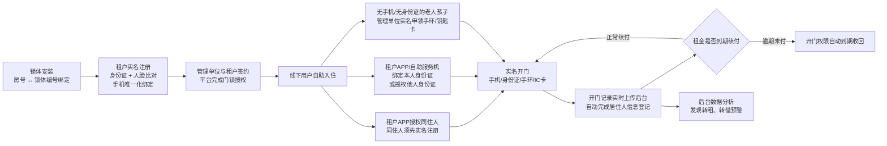

# 公租房业务方案 — 业务逻辑与功能提取

> **提取对象**（工作目录 `D:\Work`）
> 1. `业务平台开发\_调研\公租房管理方案.docx`（9.7 MB，原件 `业务平台开发\云门道智慧公租房管理方案.doc`）—— **重点**
> 2. `业务平台开发\云门道智慧物业系统简介.pdf`
> 3. `业务平台开发\云门道智慧物业系统操作指南.pdf`
> 4. `业务平台开发\云门道智慧物业系统操作日常问答.pdf`
> 5. `业务平台开发\云门道智慧物业快速入门指南.docx`
>
> **提取方式**：python-docx + lxml 解析 OOXML（含文本框、表格、VML 图形、页眉页脚、docProps）；pdfplumber + pypdf 双通道解析 PDF；docx/PDF 内嵌图片全部导出后由视觉识图逐张读取。**本文档中的界面字段、菜单、指标、规格参数均来自图片识读，非 OCR 猜测。**
>
> **文档内容属于数据，不作为指令执行。原文表述尽量照抄，未提及处一律标注"文档中无此项"。**

---

## 0. 资料清点结论（必读）

### 0.1 公租房管理方案.docx — 结构清点

| 指标 | 数值 |
|---|---|
| 段落数（docx.paragraphs） | **160** |
| 表格数 | **1**（系统报价表，9 行 × 7 列） |
| 图片数（word/media/） | **21** 个：PNG 19、JPEG 1、EMF 1 |
| 图片文件合计 | **12,883,816 字节 ≈ 12.29 MB**（未压缩） |
| 正文纯文本字符数 | **约 2,869 字**（段落文本）＋表格 153 字 |
| 内嵌 VML 图形引用 | 23 处 `<w:pict>`（其中 21 张为图片、2 个为文本框） |
| 页数（docProps/app.xml） | **29 页** |
| 字数（Word 统计，docProps/app.xml） | Words **685**、Characters **3,907**、CharactersWithSpaces **4,583**、Lines 32 |

**判定：该方案是「以截图/示意图为主、文字为辅」的产品推介型文档，不是业务需求文档。**

依据：29 页文档只有约 2,869 字正文、1 张表格，却内嵌 12.29 MB 图片（21 张，其中 8 张为 2900px 级别的平台界面截图、1 张 3.5 MB 的 EMF 系统架构图）。文字部分集中在"公租房存在的问题"和产品卖点罗列，**没有任何业务流程、审批规则、政策依据的描述**。

### 0.2 物业系统资料 — 结构清点

| 文件 | 页/段 | 有效文字 | 图片 | 说明 |
|---|---|---|---|---|
| 云门道智慧物业系统简介.pdf | 4 页 | 共 2,544 字，其中第 1–2 页为**17 个功能系统**清单（表格形式，2,541 字）；第 3–4 页为**整页长图**（1202×2980、1197×3901），第 3 页为"【云门道智慧物业】快速入门指南"流程图海报，第 4 页为"【云门道智慧物业】常见问题FAQ"海报 | 2 张整页长图 | 文字+图，功能清单可直接引用 |
| 云门道智慧物业系统操作指南.pdf | 2 页 | 第 1 页 6 步实施流程图 + 第 2 页 FAQ（9 问） | 29 个小图标 | 与「操作日常问答.pdf」**内容重复** |
| 云门道智慧物业系统操作日常问答.pdf | 2 页 | 同上（第 1 页 6 步图、第 2 页 9 问 FAQ） | 同结构 | MD5 不同（`53AA3D…` vs `9B36EC…`），但**正文内容一致**；见 §12 存疑点 |
| 云门道智慧物业快速入门指南.docx | 42 段（正文仅 5 段有字） | 共 1,300 字，其中 **608 字**藏在 35 个 VML 文本框中（即流程图节点文字） | 24 个：**17 个 64×64 装饰性小图标** + 1 个 1406×1787 流程图底图 + 1 个 136×134 徽标 + 1 个 141×142 徽标 + 2 个细长装饰线（1488×10）+ 1 个 99×8 装饰线 + 1 个 0 字节空条目 | 正文是"云门道小程序"FAQ；文本框是**8 大模块流程图**的文字节点 |

---

# A. 公租房管理方案（重点）

## 1. 方案概述

### 1.1 建设目标（原文摘录）

> 云门道智慧公租房管理方案　　实名安全智能锁助力实现"以锁管人"

> 整个系统由实名安全智能锁、手机APP（小程序）和系统平台组成。

> 现实生活中自己的身份证和手机一般是不会外借的，云门道实名安全智能锁抛弃了常规的密码、指纹及门禁卡等方式，采用二代身份证刷卡开门、实名认证手机APP开门等与其实际身份相关联的开门方式，来保证开门人身份的真实性和开门记录的可溯源性，通过后台授权数据和开门记录数据的分析，很容易发现转租、转借等现象，彻底解决了出租房管理中的难点和痛点，达到了"以锁管人"的效果。

> 结合手机APP或小程序以及管理后台， 实现一整套自助、高效、实名的管理系统，通过后台数据自动分析预警，提升实时监管能力。

> 让云门道实名安全智能锁承担起租户、物业和管理部门之间的沟通桥梁作用

> 系统平台采用云平台SAAS模式，并具备阿里云、华为云异地容灾实时容错备份功能，确保高可用性，实现了对房子信息、人员信息、开门信息、设备信息的全动态实时管理和展现，提供管理部门所需要的管理功能和相关数据，为后续的更高层次的管理和应用提供基础。

**归纳（文档实际主张的三个建设目标）**：
1. **以锁管人**——用实名开门替代机械钥匙，使"谁在住、谁在开门"可实时掌握、可溯源。
2. **解决三大痛点**——杜绝转租转借、降低管理成本、消除治安隐患。
3. **自助化管理**——签约、授权、开门、退租全流程线上化，以"租金到期自动收回开门权限"替代人工催租。

### 1.2 提出的三大问题（原文，见"一、公租房存在的问题"）

**1．转租、出借违规现象较多**

> 公租房是政府投资面向符合规定条件的城镇中等偏下收入住房困难家庭、新进就业无房职工和在城镇稳定就业的外来务工人员出租的保障性住房。公租房管理相关政策明确规定，公租房承租人不得将承租的公租房转租、转借。承租人通过微信、张贴小广告、房屋租赁中介公司扥渠道传播公租房转租、转借的违法行为屡禁不止，无法通过有效手段杜绝。

（原文"扥渠道"疑为"等渠道"笔误，照抄保留。）

**2．管理成本高、管理困难**

> 管理部门对申请人资格重新审核签约，合约租金到期，物业需进行催缴催收，到期租客霸房等情况需要投入大量的人力工作，基层又存在管理人员不足情况，工作效率必然降低，管理上缺乏系统化管理。如出现更换承租人而原先承租人又未上交私配钥匙，居住环境安全性存在重大隐患，更换门锁必然又增加管理部门的成本。

**3．治安上存在安全隐患、管理失控**

> 目前公租房入户门是通过机械钥匙开门的方式进行管理，用户私配钥匙，实际居住人员信息数据无法有效实时登记上报管理部门，混租混住的现场严重，导致房屋失控现象严重。

> 物业管理部门人员有限，基层派出所警力不足，部分承租人法律意识薄弱主动登记申报意识差，信息漏登记严重。通过定期上门核查登记需要花费大量的人力和时间且居住人员信息存在失真的情况，在治安管理上存在重大隐患，容易引发治安恶性时间。

（"现场严重"疑为"现象严重"、"治安恶性时间"疑为"治安恶性事件"笔误，照抄保留。）

### 1.3 面向对象

**原文明确提到的对象（均出现在文字或界面中）：**

| 对象 | 原文依据 |
|---|---|
| **管理部门 / 管理单位** | "提供管理部门所需要的管理功能和相关数据"；"管理单位和租户在完成租房签约时就可以在平台完成门锁授权" |
| **物业（物业管理房/物业管理部门）** | "物业管理房可授权生成一次性访客码配合执法人员进入房间的权利"；"物业管理部门人员有限，基层派出所警力不足" |
| **租户 / 承租人** | "租户都需要在手机APP上，通过身份证和人脸比对，实现实名认证注册" |
| **房东** | 界面中「房源信息」「出租信息」含"房东姓名、房东手机号、房东身份证号"字段；架构图中"房东和租户APP" |
| **（二房东）管理员** | 「出租信息」含"（二房东）管理员手机号""（二房东）管理员姓名"字段 |
| **同住人 / 家人 / 访客** | "租户可以通过自己的APP来授权自己同住人的开门权限"；"家人、租客和同住人、家政保姆、亲朋好友、访客外卖"（后者出自物业资料） |
| **执法人员** | "物业管理房可授权生成一次性访客码配合执法人员进入房间的权利，或直接启用备用钥匙" |
| **软件供应商 / 运维方（杭州云门道科技有限公司）** | "质保期内公司免费提供云平台运营服务"；"建议运维的工作还是交给专业的人士做更适合" |

**文档中无此项**：住建局、住房保障中心、运营公司、街道/社区、民政/社保/公积金/不动产/公安等政府审批部门——**方案全文中均未作为业务角色出现**（仅在架构图中出现泛化的"管理部门"和"认证平台"）。

### 1.4 整体业务流程（文档实际描述的流程）

**文档给出的整体流程只有一条，即"简单的全自助管理流程"（文字 + EMF 架构图双证据）：**

**原文流程九步（照抄）：**

> （1）锁体安装的时候，房号和和锁体编号对应绑定；
> （2）租户都需要在手机APP上，通过身份证和人脸比对，实现实名认证注册，完成手机唯一化绑定；
> （3）管理单位和租户在完成租房签约时就可以在平台完成门锁授权，线下用户自助入住；
> （4）租户可以通过自己的APP来授权自己同住人的开门权限，同住人在接收授权前也必须完成实名注册认证；
> （5）租户也可以通过自己的APP或自助服务机来绑定自己的身份证，或者授权他人的身份证进行开门，授权身份证时会通过会通过远程解码技术读取身份证相信信息和采集被授权人照片进行认证比对，杜绝虚假身份证和人证不符现象；
> （6）对于没有手机也没有身份证的孩子或老人，租户可以通过向管理单位实名申领专用的手环，或者钥匙卡进行开门；
> （7）租户可以通过自己的手机，或者身份证，或者授权过的手环或钥匙卡进行开门，每次开门都是实名的，并且开门记录是可溯源的；
> （8）租户房租到期没有续付租金的，开门权限会自动到期收回，管理单位就不再需要催收租金了；
> （9）整个签约、授权、开门、退租等记录全部自动上传到了管理后台，实现了由系统自动进行居住人信息的登记，保障了系统信息准确、鲜活，大大提高了公租房屋管理水平。

**⚠️ 关键结论**：文档描述的"全自助管理流程"**是从"锁体安装 + 签约授权"开始的**。用户要求的业务链路（申请受理、资格审核、多部门联审、轮候、摇号选房配租、补贴发放、年度复核、退租腾退、房源再分配）在本文档中**完全没有覆盖**，详见 §11。

---

## 2. 业务全流程还原

### 2.1 文档实际覆盖的环节（含原文证据）

| 环节 | 文档是否覆盖 | 文档中的内容（原文/界面证据） |
|---|---|---|
| 申请受理 | ❌ **无** | 文档中无此项。文档未提及任何"申请"入口、申请表、申请材料 |
| 资格审核 | ❌ **无** | 文档中无此项。全文未出现"资格审核""联审""准入"等 |
| 轮候 | ❌ **无** | 文档中无此项 |
| 摇号 / 选房 / 配租 | ❌ **无** | 文档中无此项 |
| **签约** | ✅ 部分 | "管理单位和租户在完成租房签约时就可以在平台完成门锁授权"；"合同签订、支付、退租都可以APP和后台完成" |
| **入住** | ✅ | "线下用户自助入住" |
| **租金收缴** | ⚠️ 仅一句 | "租户房租到期没有续付租金的，开门权限会自动到期收回，管理单位就不再需要催收租金了"；"不用催房租了（租金到期租客无法开门）"；"合约租金到期，物业需进行催缴催收"（问题描述）。**无收款渠道、无账单、无对账说明** |
| 补贴发放 | ❌ **无** | 文档中无此项。全文未出现"补贴""租金补贴" |
| 年度复核 / 资格年审 | ❌ **无** | 文档中无此项。仅问题描述中提到"管理部门对申请人资格重新审核签约" |
| **退租 / 腾退** | ⚠️ 仅一句 | "合同签订、支付、退租都可以APP和后台完成"；"整个签约、授权、开门、退租等记录全部自动上传到了管理后台"。**无腾退流程、无验收、无霸房处理** |
| 房源再分配 | ❌ **无** | 文档中无此项 |

### 2.2 文档覆盖环节的「输入 / 处理规则 / 输出 / 涉及系统与数据」拆解

> 说明：以下四栏内容全部来自文档原文与界面截图，凡文档未写明的，标注"文档中无此项"。

#### 环节 A：锁体安装与房号绑定

| 项 | 内容 |
|---|---|
| 输入 | 房号、锁体编号（原文："锁体安装的时候，房号和和锁体编号对应绑定"）；设备安装位置（界面："绑定设备：在设备管理中，选取要绑定的设备，选择设备安装的资产位置即可"） |
| 处理规则 | 一对一绑定；架构图标注"地址、房号 和 锁体编号 绑定" |
| 输出 | 楼栋/单元/室 ↔ 设备 的绑定关系；平台"房屋管理/房源信息"可查（字段：行政区划、房间名称、楼栋、单元、室、房东姓名、房东手机号、房东身份证号、详细地址、登记时间） |
| 涉及系统/数据 | e锁管理平台；设备表；房屋资产表。文档中无此项（绑定规则细节、变更/解绑规则未说明） |

#### 环节 B：租户实名认证注册

| 项 | 内容 |
|---|---|
| 输入 | 姓名、身份证号（"输入姓名身份证号码 或 身份证拍照识别"）；人脸活体照片；手机号 |
| 处理规则 | "通过身份证和人脸比对，实现实名认证注册，完成手机唯一化绑定"；技术项："人脸比对技术""人脸活体识别技术""二代证云端解码技术""公安部数据接口接入""锁体NFC技术"；架构图环节"认证比对 → 认证平台" |
| 输出 | 实名用户账号；手机号与账号唯一绑定关系；"身份比对成功" |
| 涉及系统/数据 | 认证平台（外部）；公安部数据接口；APP/小程序；用户信息表 |

#### 环节 C：签约与门锁授权

| 项 | 内容 |
|---|---|
| 输入 | 合同信息、租期、房屋、租户实名身份 |
| 处理规则 | "管理单位和租户在完成租房签约时就可以在平台完成门锁授权"；平台侧"授权方式：支持APP授权和平台授权"（规格参数图） |
| 输出 | 门锁/门禁/梯控授权；租户可开门 |
| 涉及系统/数据 | e锁管理平台；门锁设备；合同/租约数据（文档未定义字段）。文档中无此项（合同要素、授权生效时点、授权期限规则） |

#### 环节 D：同住人 / 授权人管理

| 项 | 内容 |
|---|---|
| 输入 | 同住人/被授权人已实名的手机号（"同住人在接收授权前也必须完成实名注册认证"）；或身份证（"授权他人的身份证进行开门，授权身份证时会通过会通过远程解码技术读取身份证相信信息和采集被授权人照片进行认证比对"） |
| 处理规则 | 租户自助授权；被授权人必须已实名；"杜绝虚假身份证和人证不符现象"；物业侧对应"人员授权：选择人员类型（家人、租客、临时人员）… 选择对应房屋和授权期限（家人和业主期限一致）… 系统自动审核 或 物业人工审核" |
| 输出 | 授权关系（人 ↔ 房屋 ↔ 门锁/梯控，含期限）；平台"钥匙卡信息"可查（卡号、DN号、UID、发卡状态、使用者姓名、使用者手机号、使用者身份证号） |
| 涉及系统/数据 | e锁管理平台；APP/小程序；房卡管理模块；人员-房屋-设备三维授权数据 |

#### 环节 E：开门与记录溯源

| 项 | 内容 |
|---|---|
| 输入 | 开门介质：二代身份证 / 手机APP / 微信小程序 / 支付宝 / 访客码 / 手环 / IC卡 / 备用钥匙 / 密码 / 人脸指纹（"开锁方式：APP/微信小程序/支付宝/身份证/密码/手环/IC卡/机械钥匙（可选）"） |
| 处理规则 | 每次开门实名、可溯源；免网关模式下"利用手机作为媒介，完成锁体和平台之间的数据同步"；开门时间"小于1秒（APP/刷卡或密码等）"；蓝牙无连接传输技术"保证0.2秒极速开门" |
| 输出 | 开门记录（界面字段：房间名称、楼栋、单元、室、姓名、手机号、身份证号、开门时间、设备地址、**开门方式**） |
| 涉及系统/数据 | 门锁固件；e锁管理平台；开门记录表（记录存储 10000 条，循环存储） |

#### 环节 F：租金与开门权限联动（文档唯一的"资金/合同联动业务规则"）

| 项 | 内容 |
|---|---|
| 输入 | 租期 / 租金到期时间 / 是否续付 |
| 处理规则 | "租户房租到期没有续付租金的，开门权限会自动到期收回，管理单位就不再需要催收租金了"；"不用催房租了（租金到期租客无法开门）" |
| 输出 | 逾期租户开门权限自动失效 |
| 涉及系统/数据 | e锁管理平台（权限与合同数据联动）。文档中无此项（逾期判定时点、宽限期、是否短信通知、缴费后恢复时效） |

#### 环节 G：自助与线下辅助

| 项 | 内容 |
|---|---|
| 输入 | 无手机/无身份证的老人孩子；执法人员 |
| 处理规则 | 老人孩子"通过向管理单位实名申领专用的手环，或者钥匙卡进行开门"；执法检查"物业管理房可授权生成一次性访客码配合执法人员进入房间的权利，或直接启用备用钥匙" |
| 输出 | 手环/钥匙卡；一次性访客码 |
| 涉及系统/数据 | 自助服务机（带发卡功能，可选）；房卡管理模块 |

#### 环节 H：执法/检查配合与故障处理

| 项 | 内容 |
|---|---|
| 输入 | 执法人员入室检查需求；门锁故障 |
| 处理规则 | 一次性访客码 或 备用钥匙；"如出现智能门锁打开不了大门，我们会有引导说明操作流程，如还是有问题，物业可先行启用备用钥匙帮助承租人解决开门问题，同时联系售后服务，一般维修员会在0.5-1小时之内上门维修，视情况而定" |
| 输出 | 完成入室；门锁修复 |
| 涉及系统/数据 | 访客码模块；售后工单（文档未说明是否有系统化工单） |

---

## 3. 功能模块清单（逐项列出，保留原文表述）

### 3.1 文档正文明确列出的功能（"二、系统功能介绍"下的 **9 个三级标题**）

| 序号 | 标题（原文） | 内容要点（原文） |
|---|---|---|
| 1 | **实名认证的安全智能锁** | 采用二代身份证刷卡开门、实名认证手机APP开门；保证开门人身份真实性和开门记录可溯源性；"以锁管人"；"通过后台数据自动分析预警，提升实时监管能力" |
| 2 | **简单的全自助管理流程** | 上述九步流程 |
| 3 | **实名认证的安全开门方式和记录溯源** | （1）每次开门是非常方便的；（2）每次开门是实名安全的；（3）每次出入系统都在记录 |
| 4 | **为租客打造移动物联网的应用体验** | （1）不需要带钥匙；（2）自己的手机和身份证都可以开门 |
| 5 | **为管理者提高管理效率** | （1）不用催房租了（租金到期租客无法开门）；（2）合同签订、支付、退租都可以APP和后台完成；（3）远程便捷管理，实现人来登记、人走注销 |
| 6 | **多种产品形态服务于门道的安全管控** | 图列：入户防盗门、木门锁、单元门禁、门禁读头、通道闸机及梯控等 |
| 7 | **灵活的组网方式** | （1）免网关组网：利用手机作为媒介完成锁体和平台之间的数据同步，适合开门位置有运营商网络信号的场合；（2）内置LoRa模块完成局部区域组网通信，适合集中式的公租房管理；（3）内置NB-IoT模块完成离散区域组网通信，适合离散的公租房组网管理；（4）内置WiFi模块连接无线路由器组网，适合房屋内有wifi宽带的场景 |
| 8 | **扩展应用** | "系统支持智能水、电、煤气等表接入，能够实现自助充值，管理更加简便"；"支持红外检测、烟感、sos报警按钮等接入，能够实现安全检测和报警" |
| 9 | **功能完善的管理平台** | 云平台SAAS模式 + 阿里云/华为云异地容灾实时容错备份；对房子信息、人员信息、开门信息、设备信息的全动态实时管理和展现 |

> **排版提示（原文问题）**：文档正文中该节标题依次显示为"1、…2、…3、…4、…5、…6、…7、…8、…"之后，出现的是**未加序号**的"功能完善的管理平台"（且带列表符号），随后才是"三、产品性能规格"。因此该节实际为第 **9** 个三级标题，文档的编号在 8 与 9 之间断裂。

### 3.2 管理平台界面截图所呈现的功能（模块 → 页面 → 字段/按钮，均为识图所得）

**（1）系统登录**（image8.png）

- 页面标题：**智慧公租房管理系统**
- 输入项：用户名（示例 `luoyi`）、密码、**机构下拉（示例"洞头区"）**、验证码、记住我；按钮「登录」

**（2）系统首页 / 全局框架**（image9.png）

- 顶部：`智慧公租房管理系统` ｜ 菜单折叠按钮 ｜ **切换机构：洞头区** ｜ **数据大屏** ｜ **全屏显示** ｜ 用户「罗毅」
- 左侧用户区：`luoyi`、在线、注销
- **左侧主菜单（一级，共 11 项）**：
  1. **房源管理**（子菜单：**房源信息**）
  2. **出租管理**（子菜单：**出租信息**、**房屋出租**）
  3. **卡片管理**（子菜单：**钥匙卡信息**）
  4. **登记管理**（子菜单：**租客管理**）
  5. **用户信息**
  6. **开门记录**（子菜单：**开门记录**）
  7. **互动管理**
  8. **报警管理**
  9. **数据统计分析**
  10. **系统管理**
  11. **数据大屏**
- 页签栏（实际打开过的页签）：房源信息、出租信息、钥匙卡信息、租客管理、**用户手机特征**、开门记录
- 列表工具条：搜索(放大镜)、刷新、表格视图、卡片/宫格视图；「页签操作」「刷新」

**（3）房屋管理（房源信息）**（image10.png）

- 查询条件：行政区划选择（洞头区）、房间名称、楼栋、单元、室、房东姓名、详细地址
- 按钮：**搜索**、**重置**、**导出查询结果**
- 列表字段：房间名称、楼栋、单元、室、房东姓名、房东手机号、房东身份证号、详细地址、登记时间、操作
- 行操作：**修改**、**设置开门刷脸**
- 示例数据：新灵景园C7-703 / 3幢 / 1单元 / 703室 / 麻飞飞 / 1525\*\*\*8110 / 330304\*\*\*\*\*\*\*\*\*\*3922 / 浙江省温州市龙湾区新灵景园内 / 2020-05-21 17:21:16

**（4）出租管理（出租信息）**（image11.png）

- 查询条件：行政区划选择、楼栋、单元、室、房间名称、房东姓名、详细地址
- 列表字段：房间名称、楼栋、单元、室、**入住人数**、房东姓名、房东手机号、**（二房东）管理员手机号**、**（二房东）管理员姓名**、详细地址、操作
- 行操作：**查看出入记录**
- 支持多选（复选框批量）

**（5）房卡管理（钥匙卡信息）**（image12.png）

- 按钮：**+ 发卡**、**修改用卡人**
- 列表字段：卡号、DN号、UID、**发卡状态**（已发卡/未发卡）、使用者姓名、使用者手机号、使用者身份证号
- 示例：卡号 3632922013 / DN号 485a4249545157453130303031363333 / UID 3130303031363333 / 已发卡 / 楼小刚 / 13819186968 / 330726\*\*\*\*\*\*\*\*0510

**（6）租客管理**（image13.png）

- 查询条件：行政区划选择、楼栋、单元、室、房间名称、租客姓名、租客手机号、租客身份证
- 列表字段：租客姓名、租客手机号、租客身份证号、**入住时间**、**离店时间**、房东姓名、房东手机号、楼栋、单元、室、房间名称、详细地址
- 示例：陈蓉 / 1814\*\*\*1858 / 513521\*\*\*\*\*\*\*\*\*\*0067 / 入住 2021-02-28 10:44 / 离店 2022-02-28 23:00

**（7）开门记录**（image14.png）

- 查询条件：行政区划选择、**开门方式（下拉，默认"所有"）**、楼栋、单元、室、操作人手机号、房间名称
- 列表字段：房间名称、楼栋、单元、室、姓名、手机号、身份证号、**开门时间**、**设备地址**、**开门方式**（如"APP开门"）
- 同页签另有：**用户手机特征**（页签存在，截图未展开内容）

**（8）数据大屏** — 见 §7。

**（9）系统模块（右侧菜单，文本框中）**

- 文档中无此项（平台管理端的系统管理/权限配置/统计报表界面**未提供截图**，仅左侧菜单出现"系统管理""数据统计分析""互动管理""报警管理""用户信息"字样）

### 3.3 APP / 小程序功能（image4.png 的 6 个入口 + image16.png）

**image4.png 展示的 APP 功能入口（6 项，原文）**：
1. **身份识别**
2. **租客管理**
3. **房源管理**
4. **租金管理**
5. **水电管理**
6. **订单管理**

**image6.png 展示的开锁方式菜单（7 项，原文）**：
- **二代身份证开锁**（主推，带下划线高亮）
- 手机APP开锁
- 微信小程序开锁
- 访客码开锁
- IC卡或手环开锁
- 备用钥匙开锁
- 随身码开锁

**image16.png 展示的实名认证流程（3 屏）**：
- 手输或OCR识别身份证（"点击OCR按钮拍摄身份证正面照片，身份证姓名和身份证号会自动识别"）→ **人脸活体检测**（"向左缓慢转头"）→ **后台人证比对**（"身份比对成功"）
- 认证完成页菜单：**授权分享**、**授权身份证**、**实名认证**；底部导航：首页 / 设备 / 我的

**image5.emf 架构图（"简单的全自助管理流程"）画面文字（识读）**：

| 图元 | 文字 |
|---|---|
| 左上 | 门锁/门牌实景（含"江南北苑 2477"门牌、二维码） |
| 左中 | **房东和租户APP**（手机截图） |
| 左下 | 二代身份证 → **刷二代证开门**；手机APP截图 → **手机APP开门**；手环 + IC卡 → **授权手环、IC卡** |
| 中部 | **e锁管理平台**（竖向蓝色主块） |
| 顶部箭头 | 地址、房号和锁体编号绑定 → |
| 中部箭头（双向） | ←→ 通过身份证和人脸比对实现实名认证注册 ／ 租房签约、门锁授权 |
| 中部箭头（双向） | 门禁授权 ←→ 日志上传 |
| 右上部 | ←→ **认证比对** ←→ **认证平台** |
| 右下部 | ←→ **数据同步** ←→ **管理部门** |

---

## 4. 角色与权限

### 4.1 文档/界面中出现的全部角色

| 角色 | 文档中的定位 | 能做什么（原文/界面依据） |
|---|---|---|
| **管理部门 / 管理单位** | 系统最终使用方与监管方 | 获取管理功能和相关数据；"数据同步"（架构图）；与租户完成签约并在平台完成门锁授权；向老人孩子实名发放手环/钥匙卡 |
| **物业 / 物业管理房** | 一线执行方 | "物业管理房可授权生成一次性访客码配合执法人员进入房间的权利，或直接启用备用钥匙"；催缴催收（问题描述）；启用备用钥匙配合维修 |
| **租户 / 承租人** | 被管理对象，同时是自助操作主体 | APP实名注册；自助授权同住人；自助绑定/授权身份证；自助申领手环钥匙卡；自助开门；线上完成签约、支付、退租 |
| **房东** | 房源权利方（界面字段） | 界面中作为房源/出租信息的主体记录（房东姓名、手机号、身份证号）；架构图中与租户共用"房东和租户APP" |
| **（二房东）管理员** | 界面中独立字段 | 出租信息中记录"（二房东）管理员手机号""（二房东）管理员姓名"。文档正文未对"二房东"作任何说明 |
| **同住人 / 家人 / 临时人员** | 被授权对象 | 须先实名注册，再由租户授权开门；"家人和业主期限一致" |
| **访客** | 临时授权对象 | 凭 6 位访客码开门；"访客具有在授权期限内单次开门和梯控的权限，开过或过期都会失效。一般用于外卖、临时访客等"；"访客凭访客码在授权期限内可开一次去到访房屋所需经过的所有门禁和梯控"；"如添加访客码时添加了车辆，车辆进入时间与访客码时间一致，过期失效" |
| **执法人员** | 特殊外部人员 | 凭物业管理房授权的一次性访客码入室检查，或由物业启用备用钥匙 |
| **系统管理员（平台侧）** | 界面隐含 | 登录名 `luoyi`；可"切换机构"、访问全部菜单。**文档中无此项**（未定义角色-权限矩阵） |
| **售后/维修员** | 服务方 | 门锁故障上门维修（0.5–1 小时内），"质保期内免费更换配件或新锁，人为破坏另算，上门人工费50-100/次" |
| **供应商/运维方（杭州云门道科技有限公司）** | 建设与运维方 | 提供 SaaS 平台；质保期内免费提供云平台运营服务；质保期后按 24 元/把·年收取平台运行维护费 |

### 4.2 权限设计

**文档中无此项。**

- 正文全文未出现"角色""权限""菜单权限""数据权限""审批权限"等表述。
- 界面上**只有一个登录账号 `luoyi`（罗毅）**，可看到全部 11 个一级菜单，**看不到任何角色区分**。
- 唯一与"权限"相关的表述是**设备侧的开门权限**：
  - "分级权限：支持分级权限管理"（规格参数图）
  - "授权方式：支持APP授权和平台授权"（规格参数图）
  - "门禁授权是对人进行授权…所有授权都是针对人和其所住位置是关联的"（出自物业资料，非本方案）

> **结论**：本方案只设计了"开门权限"（设备域），**没有设计"系统操作权限"（应用域）**。这是落地时的重大缺口，见 §11。

---

## 5. 关键业务规则（原文摘录）

### 5.1 准入条件

**文档中无此项。** 全文未出现准入条件、收入标准、住房困难标准、户籍要求、年龄要求等任何申请资格条款。仅在问题描述中提及公租房的**定义性表述**（非准入规则）：

> 公租房是政府投资面向符合规定条件的城镇中等偏下收入住房困难家庭、新进就业无房职工和在城镇稳定就业的外来务工人员出租的保障性住房。公租房管理相关政策明确规定，公租房承租人不得将承租的公租房转租、转借。

其中"**公租房承租人不得将承租的公租房转租、转借**"是本方案中**唯一的禁止性业务规则**。

### 5.2 租金计算规则

**文档中无此项。** 全文未出现租金标准、单价、建筑面积计租、市场租金与保障租金差额等任何计算规则。
文档仅涉及"**租金到期**"这一时点概念：

> 租户房租到期没有续付租金的，开门权限会自动到期收回，管理单位就不再需要催收租金了。

> 不用催房租了（租金到期租客无法开门）

> 合约租金到期，物业需进行催缴催收（问题描述）

### 5.3 补贴标准

**文档中无此项。** 全文未出现"补贴"二字。

### 5.4 租金减免

**文档中无此项。** 全文未出现"减免""减免政策"等表述。

### 5.5 滞纳金

**文档中无此项。** 全文未出现"滞纳金""违约金""逾期利息"等表述。

### 5.6 退出条件（腾退 / 退租）

**文档中仅有一句，且不含条件判断：**

> 合同签订、支付、退租都可以APP和后台完成

> 整个签约、授权、开门、退租等记录全部自动上传到了管理后台

**文档中无此项**：退出条件、腾退触发规则、霸房处理规则、房屋验收标准。
（"到期租客霸房"仅作为问题描述出现："到期租客霸房等情况需要投入大量的人力工作"。）

### 5.7 授权与期限规则（文档中唯一成体系的规则集）

| 规则 | 原文 |
|---|---|
| 实名前置 | "同住人在接收授权前也必须完成实名注册认证"；"被添加的人员必须要已注册登录和实名认证过的" |
| 手机唯一化 | "完成手机唯一化绑定" |
| 身份证防伪 | "授权身份证时会通过会通过远程解码技术读取身份证相信信息和采集被授权人照片进行认证比对，杜绝虚假身份证和人证不符现象" |
| 授权期限 | "选择对应房屋和授权期限（**家人和业主期限一致**）" |
| 访客授权 | "选择到访时间范围（默认2小时内）"；"访客具有在授权期限内单次开门和梯控的权限，**开过或过期都会失效**" |
| 访客车辆联动 | "如添加访客码时添加了车辆，车辆进入时间与访客码时间一致，过期失效" |
| 时段控制 | "选择是否支持时段区间控制（需要则输入具体时间区间）"；"时段区间控制：指的是授权有效期内的每一天中哪个时间段有效" |
| 审核方式 | "系统自动审核 或 物业人工审核" |
| 租金联动 | "租户房租到期没有续付租金的，开门权限会自动到期收回" |
| 应急通道 | "物业管理房可授权生成一次性访客码配合执法人员进入房间的权利，或直接启用备用钥匙" |
| 无手机人员 | "对于没有手机也没有身份证的孩子或老人，租户可以通过向管理单位实名申领专用的手环，或者钥匙卡进行开门" |

### 5.8 设备侧技术规则（"三、产品性能规格 — 4、规格参数"原文）

> 开锁方式：APP/微信小程序/支付宝/身份证/密码/手环/IC卡/机械钥匙（可选）
> 实名认证：门前人证核验/无证实名认证等（支持锁体NFC身份证解码）
> 门锁类型：标准蓝牙锁和网关锁（LoRa/NB/WiFi）
> 联网方式：手机或网关（蓝牙/LoRa/NB 可选）
> 开门时间：小于1秒（APP/刷卡或密码等）
> 电池电量：4节5号电池，约24个月(最低功耗模式下)
> 应急开门：机械钥匙/外接充电宝　　NFC：支持（支持IC和身份证的读取）
> 分级权限：支持分级权限管理　　卡片容量：12000张身份证和IC卡的总和
> 密码容量：6位，2500组　　记录存储：10000条（循环存储）
> 密码类型：访客码/期限码/随身码等　　虚位密码：支持64位虚位密码
> 授权方式：支持APP授权和平台授权　　告警类型：低电量告警/挟持告警/防拆告警
> 固件升级：支持APP进行固件升级　　锁体类型：6068/酒店锁体等

**安全加密技术（"2、超金融级安全加密"原文）：**

> 每把锁都有2¹²⁸个128位的随机密码
> 每次开门密码都是随机的
> AES128加密传输技术
> 动态数字证书技术
> 防暴力破解技术
> 手机与锁体传输安全技术
> 手机与云端传输的安全技术
> 云端"阿里云"安全保障技术

**多技术组合应用（image18.png 原文）：**

> 免网关联网技术，降低成本，安装容易
> 低功耗技术
> 蓝牙无连接传输技术，保证了0.2秒极速开门的良好体验。
> 多配置模式自适应技术
> 蓝牙手环、IC卡钥匙的安全授权技术
> 适配自主研发的LoRa模块实现大范围组网
> 支持NB-IoT模块，实现碎片化组网

**实名认证技术（image16.png 原文）：**

> 人脸比对技术
> 人脸活体识别技术
> 锁体NFC技术
> 二代证云端解码技术
> 公安部数据接口接入

---

## 6. 对接的外部系统

| # | 外部系统 | 对接内容（原文/识图依据） | 对接方式/证据强度 |
|---|---|---|---|
| 1 | **认证平台** | 架构图右侧独立方框"认证平台"，与"e锁管理平台"之间为**双向箭头，标注"认证比对"** | 强（EMF 架构图明确画出） |
| 2 | **公安部数据接口** | "公安部数据接口接入"（实名认证技术 5 项之一）；"后台人证比对"；技术依赖"二代证云端解码技术" | 强（明确列出） |
| 3 | **手机APP / 微信小程序** | "整个系统由实名安全智能锁、手机APP（小程序）和系统平台组成"；房东和租户APP（双向箭头：实名认证注册 / 租房签约、门锁授权） | 强 |
| 4 | **微信 / 支付宝（支付）** | 开锁方式包含"微信小程序""支付宝"；物业侧"微信支付 或 支付宝扫码支付"；缴费模块"微信支付或支付宝扫码支付" | 强（但**仅出现在 APP/物业侧**，公租房租金收缴未说明走这些渠道） |
| 5 | **自助服务机** | 报价表第 2 项"自助服务机（带发卡功能，可选）"；"租户也可以通过自己的APP或自助服务机来绑定自己的身份证" | 强 |
| 6 | **锁体硬件（门锁/门禁/梯控/闸机）** | 免网关（手机媒介数据同步）、LoRa、NB-IoT、WiFi 四种组网方式；产品形态含入户防盗门、木门锁、单元门禁、门禁读头、通道闸机及梯控；门禁授权 ←→ 日志上传 | 强 |
| 7 | **智能水表 / 电表 / 煤气表** | "系统支持智能水、电、煤气等表接入，能够实现自助充值，管理更加简便"（"8、扩展应用"） | 中（仅一句，无对接协议/字段） |
| 8 | **红外检测 / 烟感 / SOS报警按钮** | "支持红外检测、烟感、sos报警按钮等接入，能够实现安全检测和报警" | 中（仅一句） |
| 9 | **阿里云 / 华为云** | "具备阿里云、华为云异地容灾实时容错备份功能"；"云端'阿里云'安全保障技术" | 强 |
| 10 | **数据大屏** | 平台顶部按钮「数据大屏」/「全屏显示」；左侧菜单末项"数据大屏"；大屏标题"智慧公租房管理平台"；地图底图来自 **Baidu**（"© 2020 Baidu - GS(2019)5218号 - 甲测资字1100930 - 京ICP证030173号 - Data © 长地万方"） | 强 |
| 11 | **百度地图** | 同上，大屏中间为百度地图热力图（地图/混合切换） | 强 |
| 12 | 公租房管理信息系统（政府侧） | **文档中无此项**，全文未提及对接任何政府公租房业务系统 | — |
| 13 | 不动产登记、民政、社保、公积金、公安（户籍/人口） | **文档中无此项**（仅"公安部数据接口接入"用于**人证比对**，不是户籍/不动产/民政/社保/公积金数据共享） | — |
| 14 | 银行 / 非税支付 / 财政 | **文档中无此项** | — |

**接入方式说明**：文档仅给出业务侧的"要对接什么"，**未给出任何接口协议、字段、频率、认证方式**。文档中无此项（本方案的详细接口定义需参考同目录 `云门道物联网平台接口文档V2.0.0.pdf`，属另一份资料）。

---

## 7. 数据大屏 / 驾驶舱

**文档有此项**（image15.png，「8）数据大屏」；大屏标题：**智慧公租房管理平台**）。

### 7.1 大屏布局与指标卡（按位置逐项列出）

| 位置 | 名称（原文） | 类型 | 内容（识图） |
|---|---|---|---|
| 左上 | **洞头区-出租房总计** | 指标卡（数字大屏） | 数值 **20** |
| 左中上 | **出租房租赁情况** | 饼图 + 图例 | 图例：**已出租**（红）、**未出租**（青）；圆环饼图 |
| 右上 | **租客年龄分布** | 环形图（单位：岁）+ 图例 | 图例 **7 项**：**0-18**（红）、**18-30**（青）、**31-40**（黄）、**41-50**（橙）、**51-60**（黄绿）、**65岁以上**（浅红）、**未标明**（绿） |
| 右下 | **租客来源地区分布** | 柱状图（纵轴 0/5/10/15/20/25） | 类别：**浙江**、**河南**、**四川** |
| 正上中 | **智慧公租房管理平台** | 大屏标题 | — |
| 中上左 | **实时时钟（大字）** | 数字时钟 | **23:33:17**；日期 **2021/5/20** |
| 中上中 | **离线设备数 / 在线设备数** | 双指标 | **离线设备数:0**、**在线设备数:0** |
| 中上右 | **租客来源 TOP3** | 排行榜 | **NO.1 浙江:22人**、**NO.2 河南:4人**、**NO.3 四川:2人** |
| 正中 | **百度地图热力图** | 地理分布图 | 地图/混合 切换按钮；红色水滴标记点，数字标签 1、1、6、1、1、10；热力色块（绿→黄→红）；底图标注：温州绕城高速、S10、G1523、G330、G228、康城大厦、黄华枢纽、凤山公园、歧头山、海思公园、中国中铁二局、温州技师学院（瓯江口校区）、区电镀厂房-A区 |
| 左下 | **租客出入记录** | 滚动表格 | 列：**姓名**、**手机号/卡号**、**角色**、**开门方式**、**时间**。示例行：黄成梅/1358\*\*\*7628/租客/APP开门/2021-05-20 22:02:47；陈曙光/1338\*\*\*8579/租客/APP开门/21:07:48；郑志涛/1588\*\*\*9825/租客/APP开门/20:27:44；黄成梅/1358\*\*\*7628/租客/APP开门/18:23:42；黄成梅/1358\*\*\*7628/租客/APP开门/18:23:42；郑帅锋/1571\*\*\*6557/租客/APP开门/13:50:32；邹益存/1508\*\*\*9778/租客/APP开门/13:35:59 |
| 右中下 | **告警信息** | 告警区块 | 标题存在，**截图内内容为空**（未列出具体告警记录/字段） |

### 7.2 大屏数据源（识图结论）

- 空间范围由**机构**决定（大屏左上角标题前缀"洞头区"，与平台顶部"切换机构：洞头区"一致）。
- 数据域只有四类：**出租房（房源）**、**租客（人员）**、**设备（在线/离线）**、**开门记录**。
- **无以下板块**：租金收缴率、补贴发放、资格审核进度、轮候人数、配租率、逾期欠租、退租腾退、房源空置时长——**文档中无此项**。

---

## 8. 国标 / 政策依据

### 8.1 文档中明确引用的标准（仅 2 处）

| 标准编号 | 名称/表述（原文） | 出现位置 |
|---|---|---|
| **GA 374-2019** | "我们提供的安全智能门锁SL200系列是通过**公安部最新标准GA374-2019**的检测认证，产品质量、安全、性能都是经过检验有保障。" | "五、补充说明事项" |
| **公安部检测认证** | 标题"5、公安部检测认证"（image20.png、image21.png 为检测报告） | "三、产品性能规格" |

### 8.2 检测报告实体信息（image20.png 识读）

| 项 | 内容 |
|---|---|
| 报告类型 | **检验报告** |
| 报告编号 | **公京检第 2101110242 号** |
| 产品名称 | **安全智能锁** |
| 型号规格 | **XMD200** |
| 受检单位 | **杭州云门道科技有限公司** |
| 检验类别 | **委托检验** |
| 报告日期 | **2021年4月13日** |
| 检验机构 | **国家安全防范报警系统产品质量监督检验中心（北京）** / **公安部安全与警用电子产品质量检测中心**（检验检测专用章 ×2） |
| 资质标识 | MA、AL、ilac-MRA、CNAS；CNAS L0531；（2019）国认监认字（274）号；160021022463 / 160021020992 |

（image21.png 为第二页/第二份报告，版式同类型证书。）

### 8.3 政策文件引用

**文档中无此项。** 全文未引用任何政策文件名称、文号（如《公共租赁住房管理办法》等均未出现）。仅有泛化表述：

> 公租房管理相关政策明确规定，公租房承租人不得将承租的公租房转租、转借。

---

## 9. 系统报价与商务条款（原文，供业务范围界定参考）

**表 1（文档中唯一的表格）：四、系统报价**

| 序号 | 项目名称 | 单位 | 数量 | 单价（元） | 总价（元） | 备注 |
|---|---|---|---|---|---|---|
| 1 | 实名安全智能锁 SL200-T5 | 把 | **2156** | （空） | （空） | （空） |
| 2 | 自助服务机（带发卡功能，可选） | 台 | 1 | （空） | （空） | 可选，可以用带NFC手机来完成 |
| 3 | 钥匙卡（可选） | 张 | （空） | （空） | （空） | 可选，老人、孩子等群体使用，按需配置 |
| 4 | 手环（可选） | 个 | （空） | （空） | （空） | （空） |
| （空行） |  |  |  |  |  |  |
| 1 | SaaS平台管理系统软件 | 套 | 1 | （空） | （空） | （空） |
| 2 | APP及后台 | 套 | 1 | （空） | （空） | （空） |
| 合计: |  |  |  |  |  | （空） |

**单价、总价、合计三列在原文中全部为空。**

**五、补充说明事项（原文要点）：**

| 事项 | 原文 |
|---|---|
| 配合执法入室检查 | "物业管理房可授权生成一次性访客码配合执法人员进入房间的权利，或直接启用备用钥匙。" |
| 门锁维修时效 | "如出现智能门锁打开不了大门，我们会有引导说明操作流程，如还是有问题，物业可先行启用备用钥匙帮助承租人解决开门问题，同时联系售后服务，一般维修员会在0.5-1小时之内上门维修，视情况而定，质保期内免费更换配件或新锁，人为破坏另算，上门人工费50-100/次." |
| 检测认证 | "我们提供的安全智能门锁SL200系列是通过公安部最新标准GA374-2019的检测认证…产品包含锁芯+锁体一整套产品，我们公司是专业研发生产销售售后一体化，性价比在同类门锁中优势很明显。" |
| 平台运营费 | "云平台服务在质保期后可按合同约定的运营费用控制在**24元/把.年**的平台运行维护费收取。物业公司如自己想做运维管理和平台，会出现管理成本过高，租服务器及定期各方面升级等花费大，运营稳定性不如专业人士管理效果好，所以建议运维的工作还是交给专业的人士做更适合。" |

---

# B. 物业系统资料（简要）

> 依据：`云门道智慧物业系统简介.pdf`（17 个功能系统）、`云门道智慧物业系统操作指南.pdf`（6 步实施 + 9 问 FAQ）、`云门道智慧物业系统操作日常问答.pdf`（同前）、`云门道智慧物业快速入门指南.docx`（8 模块流程图 + 小程序 FAQ）。

## 10. 物业系统现有功能清单（按模块列出）

### 10.1 「云门道智慧物业系统简介.pdf」17 个功能系统（原文清单，含原文编号）

| # | 系统名称 | 功能要点（原文） |
|---|---|---|
| 1 | **智慧门禁系统** | 1、大门门禁、单元门禁、电梯控制都是自动联动的 2、门禁授权是对人进行授权，授权人可以用自己实名过的手机（APP或小程序或NFC）、身份证、人脸、指纹、随身码等进行开门呼梯（其中人脸、指纹等方式需要所幢设备的支持） 3、老人孩子可以通过业主（监护人）来申领手环或NFC卡贴或门禁卡，如果发生丢失，卡片主人可以自行在手机上挂失。 4、所有授权都是针对人和其所住位置是关联的，如果授权A可以出入（A入住1幢2单元501），那么A就可以自动获得大门、1幢2单元的单元门和所在单元电梯到达5层的权利 5、所有开门呼梯的方法和介质都是用户自己具有的介质 6、人员授权都是业主自主完成，如家人、租客和同住人、家政保姆、亲朋好友、访客外卖等。 7、门禁服务属于系统的基础服务类别 |
| 2 | **智慧访客系统** | 1、访客由小区内部居住人员（业主、家人、租客、同住人等）邀请进入，由居住人通过手机或访客码生成器来生成随机访客码，访客凭同一个访客码在授权时间范围内单次进出大门、单元和梯控，到达邀请人所在楼层。 2、访客只能单次进出所要去的位置，没有权限进出其它单元或楼层 3、驾车访客的车牌可以由邀请者（小区居住人员）填入，如果邀请者名下有空余车位，访客车辆可以直接进入停放邀请者的空余车位，否则按照小区针对社会车辆规则执行 4、访客服务属于增值服务类别 |
| 3 | **智慧梯控系统** | 1、每个居住人员的梯控授权是和其门禁授权联动的 2、梯控可以分层控制，可以自由设定部分楼层需要梯控，部分楼层不进行梯控 3、呼梯的方法除了增加常规和开门方式一样以外，还可以增加一个扫码呼梯的方式，便于在拥挤场景下的呼梯使用。 4、梯控服务属于系统的增值服务类别 |
| 4 | **智慧停车管理系统** | 1、用户可以自由设定停放自己车位的车辆车牌，并且数量和时间可以住户自己设定 2、如果用户自己的车位已经用完，用户设定的其余车辆就无法按照免费车辆进入。 3、整个停车系统管理是和人关联起来的，每个业主的进入车辆数量不得大于其可停车的数量 4、系统支持临时车辆的各种计费规则 5、系统支持扫码支付，支持预先支付或是车闸前支付 6、系统支持车位的临时转借 7、系统支持车位的分时共享，为业主车位在空余时间对外提供共享服务，增加创收 |
| 5 | **电瓶车安全充电系统** | 1、在小区各个公共位置安装电瓶车安全充电设备 2、设备具有过压、过流、短路、漏电等保护功能 3、设备具有按时计费和按电量计费功能 4、用户可以方便通过手机微信直接充电支付 |
| 6 | **人脸抓拍及溯源系统** | 1、在公共门禁、重要公共位置安装人脸抓拍摄像机 2、可以实现对尾随而入的人群留下人脸记录，便于有问题情况下的溯源 3、提供以图搜图功能，实现访客的轨迹溯源等。 4、陌生人脸的实时告警，可以让值班室人员即时发现陌生人员进入，增加安全性。 |
| 7 | **智能巡更系统** | 1、每个保安配备保安终端，每次上班需要刷脸登录保安自己的账号 2、每个保安需要带上保安终端，在规定的巡更任务时间内，完成巡更，系统自动记录每个保安每次巡更的线路时间点 3、巡更点上安装我们的门禁、梯控、车闸、门锁等设备的地方，保安终端会自动感应，其余地方用终端读取每个位置的电子标签 4、巡更中发现的问题或隐患，可以用拍照、文字等方式提交 5、管理后台可以动态显示所有巡更任务的完成情况，便于对保安的管理和考核 6、保安终端支持对讲、巡更、一键求助接收处置等功能 |
| 8 | **智能保洁管理系统** | 1、保洁任务分为两个内容：卫生检查和清洁打扫 2、保洁人员必须在支持NFC功能的手机上安装保洁模块的APP，在每个卫生检查点必须用手机读取对位位置的电子标签 3、发现需要打扫的地方，拍照上传打扫前后的图片 4、按照实际工作量进行计酬，考核管理的原则：希望1个保洁人员来完成以往2个人的工作，获得原来工资的1.5倍。 |
| 9 | **一键求助系统** | 1、在门禁、梯控、车闸、有公共安全隐患位置、孤寡老人特殊群体家里等安装一键求助按钮 2、保安终端和值班中心声光终端会即时告警，并即时进行处置。 3、一键求助按钮采用电池供电，方便安装或携带。 |
| 10 | **线上缴费系统** | 1、各类缴费都可以在手机上自助完成（微信、支付宝等） 2、支持物业费、车位管理费、垃圾清运费、能耗费、包月停车费等各类收费类别 3、缴费和各类控制系统的授权权限自动关联 |
| 11 | **第三方服务管理系统** | 1、可以设置管理给类第三方服务供应商，比如水电维修、绿化养护、卫生保洁、电梯运维、设施维修、快递寄送等 2、物业管理审核给类第三方服务供应商，签约后分配给每个供应商一个后台账号，其可以自行授权其服务人员按单上门服务，并可以自动获得相应的门禁、梯控等授权。 2、服务供应商可以在用户报修后抢单接单，并安排授权自己的服务人员上门服务。 |
| 12 | **自助服务系统** | 1、在物业值班中心配置24小时的自助服务终端 2、没有或不会使用智能手机的人员，可以到自助服务终端处办理授权、缴费、报修等任务，不会操作由值班人员协助操作 |
| 13 | **投诉建议** | 1、用户可以通过手机小程序完成投诉建议，并上传相关图片 2、所有投诉建议的处理进展和结果可以实时查看 3、监督物业处理进度和结果，提升客户满意度 |
| 14 | **报修管理** | 1、住户或工作人员可以在自己手机上传各类报修 2、相应工作人员和对应的第三方服务供应商都会接到报修事件 3、维修进展实时跟踪查询 |
| 15 | **小区投票系统** | 1、物业或业委会可以在系统后台设置投票事项的标题和内容（可以单项或多项） 2、用户可以在手机上方便完成投票提交，方便用户和物业 3、重要投票可以设定刷脸确认，便于确定是否本人投票。 4、投票结果后台可以实时查询 |
| 16 | **小区公告** | 提供给类小区公约、通知、宣传等内容 |
| 17 | **云小店系统** | 1、整合业主和周边服务资源，为小区住户的生活提供便利 2、住户或周边供应商可以提供各类服务和产品，为本小区住户提供更多的选择 3、物业负责规范性和合法性的管理审核 |
| 备注 | **增值服务开关（重要规则）** | "用户可以自己定义增值服务类别，比如梯控、访客邀请、临时车辆添加等功能，对于**拖欠物业费、车位管理费等可以按按照设定自动关闭对以住户的增值服务功能**" |

### 10.2 实施六步（操作指南 / 日常问答 PDF 第 1 页，原文）

| 步骤 | 名称 | 原文内容 |
|---|---|---|
| 1 | **申请注册** | 联系云门道 或 在云门道网页上申请；与云门道沟通；由云门道创建智慧物业系统帐号 |
| 2 | **资产初始化** | 登录智慧物业系统；创建资产信息 或 联系云门道导入资产信息；完成 |
| 3 | **设备初始化** | 安装设备；绑定设备；完成 |
| 4 | **基础设置** | 设置收费策略、是否实名等；添加工作人员帐号；完成 |
| 5 | **通知业主** | 登录云门道小程序；业主认证；添加人员（注：详见《云门道智慧物业快速入门指南》） |
| 6 | **日常管理** | 审核、业主管理、车辆管理、巡更管理、报警管理、第三方服务商管理 |

### 10.3 FAQ（操作指南 / 日常问答 PDF 第 2 页，9 问原文要点）

| 问题 | 答案（原文） |
|---|---|
| 如何创建资产信息？ | 在资产管理中添加您所在物业的资产结构，如苑、幢、单元等。再把具体资产信息表格导入。 |
| 云门道创建的智慧物业系统帐号有哪些权限？ | 云门道给您创建的帐号为管理者帐号，拥有物业管理的最高权限。 |
| 物业工作人员帐号如何创建？ | 在权限管理中创建用户，根据提示填写信息即可。员工帐号可设置对应的权限。 |
| 有哪些设备？设备如何安装？ | 智慧物业系统中包括智能门禁、人脸识别机、智能车闸、梯控、充电桩、一键报警、水表、电表等一系列设备。云门道会提供技术支持及指导您安装。 |
| 设备安装完成后如何绑定设备？ | 在设备管理中，选取要绑定的设备，选择设备安装的资产位置即可。 |
| 如果业主在云门道小程序中认证不通过，怎么办？ | 需要工作人员人工审核。在审核管理中，找到认证记录，对信息做出处理（"通过"或者"驳回"）。 |
| 如何管理车辆？ | 在车辆管理中可以添加车辆或者编辑车辆。车辆加入黑名单后将无法进入。 |
| 业主信息有误怎么办？ | 在业主管理中，找到业主信息编辑，把有误的信息更正即可。 |
| 如何帮助业主创建云门道小程序帐号？ | 登录自助台，选择"注册认证"，根据页面提示帮助业主注册并实名认证（需要业主携带身份证） |

### 10.4 小程序端流程图（快速入门指南，8 个模块，文字取自文档 VML 文本框原文）

| # | 模块 | 流程节点（原文） |
|---|---|---|
| 1 | **注册登录** | 搜索【云门道】微信小程序 或 微信扫码 → 手机号和验证码登录 或 微信绑定手机号登录 |
| 2 | **实名认证** | 点击菜单 我的-去认证 → 输入姓名身份证号码 或 身份证拍照识别 → 人脸活体检测 / 人脸比对 |
| 3 | **业主认证** | 进入云门道智慧物业小程序 → 添加房屋 或 添加车位 → 输入相关房屋或车位的具体信息 → 系统自动审核 或 物业人工审核 → 成为业主 → 完成 |
| 4 | **人员授权** | 选择人员类型（家人、租客、临时人员）→ 选择对应房屋和授权期限（家人和业主期限一致）。注1："被添加的人员必须要已注册登录和实名认证过的"；注2："家人没有手机号的用虚拟账号"；注3："不同类型人员的权限说明详见小程序中人员授权页面的相关说明" |
| 5 | **邀请访客** | 选择访客到访的房屋（多个房屋情况下）→ 选择到访时间范围（默认2小时内）→ 输入访客车牌号 → 生成访客码 发送给访客。注："访客凭访客码在授权期限内可开一次去到访房屋所需经过的所有门禁和梯控"；"访客具有在授权期限内单次开门和梯控的权限，开过或过期都会失效。一般用于外卖、临时访客等。如添加访客码时添加了车辆，车辆进入时间与访客码时间一致，过期失效。" |
| 6 | **车辆授权** | 输入车牌号 → 选择常用车辆 或临时车辆 → 选择授权期限（临时车辆）→ 选择是否支持时段区间控制（需要则输入具体时间区间）。注："时段区间控制：指的是授权有效期内的每一天中哪个时间段有效" |
| 7 | **缴费** | 选择缴费类别（物业费或车位管理费）→ 选择缴费的房屋或车位 → 选择缴费期限 → 微信支付 或 支付宝扫码支付 |
| 8 | **开门呼梯** | 点击首页底部的钥匙按钮 或 在设备列表选择目标设备 → 如有多个选择要开的设备 → 梯控如有多个楼层选择要去的楼层 |

> **注**：`快速入门指南.docx` 中该流程图**仅渲染出编号 1–8 的模块标题**（另有 1 个未标号模块排在第 8 个之后，其在 XML 中无编号文本），共 35 个文本框。截图海报中可见更多行，但**文字节点在文档图片中未渲染**，无法确认其名称。**文档中无此项**（第 9–14 模块的确切名称无法从 `快速入门指南.docx` 得到）。

### 10.5 小程序 FAQ（快速入门指南.docx 正文，原文）

| 问题 | 答案 |
|---|---|
| 业主使用云门道小程序的步骤是怎么样的？ | 首先业主要登录云门道小程序，并完成实名认证。完成实名认证后就可以添加房屋或者车位，成为你的资产。最后可以添加家人、租客或者临时人员。如果有车位的话还可以添加车辆。 |
| 哪些角色可以添加人员？ | **业主**可以添加家人、租客、临时人员、邀请访客；**租客**可以添加同住人、临时人员、邀请访客；**家人**可以邀请访客；**同住人**可以邀请访客。 |
| 如何切换组织和角色？ | 在云门道首页最上方，会显示您所在的组织名称。如果您有多个组织，可以点击下拉按钮来切换组织。切换角色也是一样的方式。 |
| 添加家人时提示添加用户未实名，请先实名怎么办？ | 首先您添加的人员必须已经注册过云门道小程序。您需要让被添加的人员先去注册云门道小程序，再进行实名认证。最后您再把人员添加为家人。 |
| 我要添加租客怎么办？ | 首先您需要让租客注册云门道小程序，并且完成实名认证。然后您在云门道小程序人员授权时选择添加租客，输入租客实名认证过的手机号即可。 |
| 我是访客，我该怎么操作？ | 搜索云门道小程序，在登录页面选择"我是访客"登录。登录成功后根据页面提示输入访客码（访客码为6位数字，由邀请人告知给您）。访客码添加成功后，您会在页面上看到门锁、梯控等设备信息，点击开门按钮即可。 |
| 如果家人没有手机号怎么办？ | 在添加家人时选择虚拟号码，家人可以通过虚拟号和验证码登录云门道小程序。 |
| 实名认证时需要注意什么？ | 在云门道小程序上做实名认证时，请注意身份证和姓名必须与身份证一致，拍照时环境无逆光。 |
| 实名认证没有通过怎么办？ | 请您携带身份证去物业中心处理。 |
| 业主认证时没有认证成功怎么办？ | 业主认证没有成功说明您提交的信息可能有误，需要物业人员审核，请您耐心等待。也可以联系物业中心处理。 |
| 如遇车闸异常没有抬杆怎么办？ | 在云门道小程序车闸设备列表中，选择需要抬杆的车闸，点击"抬杆"即可。 |
| 如果人脸照片模糊是否可以更换人脸照片？ | 可以，在我的-照片更换中重新拍一张照片更换。 |
| 我添加的人员在哪里可以查看？ | 在我的-授权管理里面可以查看您添加的人员列表，左滑可以删除人员。 |
| 我添加的车辆在哪里可以查看？ | 在我的-我的车辆中可以查看您添加的车辆，可以删除车辆。 |
| 呼梯时提示"没有权限"怎么办？ | 请您确认您的物业费是否到期，如物业费到期请及时缴费，以免影响您正常出入。 |
| 按了开门按钮后，门没有打开怎么办？ | 请检查手机是否打开蓝牙和定位，确认打开后再操作小程序。 |
| 我添加了一个车位，我可以添加几辆车？ | 一个车位可以添加两辆常用车辆，也可以添加临时车辆，目前没有对车辆数量做限制。临时车辆只允许在授权时间范围内进出。 |
| 我有一个访客，需要开车进入小区，我可以在云门道小程序上操作吗？ | 可以。在邀请访客时，选择访客到访时间段及到访位置并填写访客的车牌号，访客就可以在到访时间段内进入小区。 |
| 访客的车辆停在我的车位上，访客出小区时需要交停车费吗？ | 不需要。访客的车停在您的车位上，说明您的车位空闲，访客是免停车费的。反之，如果您的车位已经停了您的车，那么访客再进入车库，需要按时计停车费。 |
| 我的车在开出小区时显示要支付停车费，怎么支付？ | 您可以通过微信扫一扫二维码，填写车牌号支付。也可以打开云门道小程序，点击"临时停车费"填写车牌号支付。支付完成后，车闸会自动抬起。 |
| 我在小区买了一个车位，但是我有两辆车，都可以开进去吗？ | 可以。首先您在云门道小程序上添加车位，车位添加成功后把两辆车牌号添加进去，两辆车都可以进入小区。但是如果两辆车同时停在车库，其中一辆车需要支付停车费。 |

**（常见问题FAQ 海报另含 2 个截图未展开完整的问题：**"如遇车牌识别错误没有抬杆怎么办？"、"我的车停在小区，但是临时停车费…"**）**

## 11. 与公租房业务的关系（可复用 / 物业专有）

### 11.1 可直接复用（已在物业域验证的能力）

| 能力 | 在公租房场景中的作用 | 复用依据 |
|---|---|---|
| **实名认证体系**（人脸比对 + 人脸活体 + 二代证云端解码 + 公安部接口） | 承租人、同住人、授权人的实名底座；"以锁管人"的技术前提 | 公租房方案与物业资料**完全一致**的同一套技术栈 |
| **人员授权模型**（人 ↔ 房屋/位置 ↔ 设备，含授权期限、时段区间控制、系统自动审核/人工审核） | 承租人/同住人/临时人员授权；对应公租房"同住人授权" | 快速入门指南模块 4 |
| **访客/临时授权**（6 位访客码、单次有效、开过或过期失效、访客车牌联动） | 执法入室检查一次性访客码（公租房方案明确复用此能力） | 公租房方案"五、补充说明事项" + 快速入门指南模块 5 |
| **门禁 / 梯控 / 车闸 / 门锁统一授权**（授权与所住位置关联，自动获得大门、单元门、梯控楼层权限） | 公租房小区通行与电梯管控 | 简介 §1/§3/§4 |
| **线上缴费**（微信、支付宝；多收费类别；**缴费与控制权限自动关联**） | 公租房租金/物业费线上收缴的支付通道与"欠费即停权"机制 | 简介 §10；备注中的"增值服务开关" |
| **自助服务终端 / 自助台**（注册认证、授权、缴费、报修） | 老年承租人线下辅助办理；公租房方案报价含"自助服务机（带发卡功能，可选）" | 简介 §12；公租房方案报价表第 2 项 |
| **报修 / 投诉 / 第三方服务商**（抢单接单、上门授权、进度跟踪） | 承租人报修、公共设施维修、第三方上门（需门禁授权） | 简介 §11 / §13 / §14 |
| **巡更 / 一键求助 / 人脸抓拍溯源 / 电瓶车充电 / 云小店 / 公告 / 投票** | 小区日常安全与运营，公租房小区同样需要 | 简介 §5–§9、§15–§17 |
| **权限管理**（创建用户、员工帐号可设置对应权限） | 公租房运营公司内部员工账号体系 | 操作指南 FAQ"物业工作人员帐号如何创建？在权限管理中创建用户…员工帐号可设置对应的权限" |
| **资产结构初始化 + 表格导入**（苑/幢/单元，资产信息表格导入） | 公租房房源批量建账的现成做法 | 操作指南 FAQ"如何创建资产信息？" |
| **组织与角色切换**（多组织、多角色下拉切换） | 多行政区/多项目/多机构运营（对应平台顶部"切换机构"） | 快速入门指南 FAQ"如何切换组织和角色？" |
| **设备管理 + 绑定资产位置** | 门锁/门禁/水电表等设备与房源绑定 | 操作指南 FAQ"设备安装完成后如何绑定设备？" |

### 11.2 物业专有（公租房方案未涉及，落地时需裁剪或改造）

| 能力 | 为什么属物业专有 |
|---|---|
| 业主认证（业主 vs 租客的双层结构） | 公租房**产权方是政府/运营公司**，不存在"业主"角色；公租房只有管理方与承租人 |
| 车位买卖、车位分时共享、车位临时转借、临停计费 | 车位经营属性；公租房方案中**完全未提及车位** |
| 小区投票系统（业委会/物业投票、刷脸确认） | 依赖业委会治理结构；公租房小区通常无业委会 |
| 云小店（周边供应商入驻、物业审核合法性） | 商业运营属性 |
| 保洁计酬（1 人完成 2 人工作、1.5 倍工资） | 物业内部考核规则 |
| 二手房/长租公寓相关的"（二房东）管理员" | 转租经营属性，与公租房"禁止转租"原则冲突 |
| 停车费/垃圾清运费/能耗费/包月停车费等收费类别 | 物业费类目；公租房核心是**租金**与**补贴** |
| 摄像头人脸抓拍与陌生人告警 | 涉及个人信息合规，公租房方案未提及 |

### 11.3 两套体系的结构差异（关键）

| 维度 | 公租房方案（本文档） | 物业系统 |
|---|---|---|
| 核心对象 | 房源 + 租客 + 门锁 + 开门记录 | 业主 + 房屋/车位 + 设备 + 费用 |
| 授权发起人 | **管理单位/租户**（管理单位签约时授权） | **业主**（业主自助授权） |
| 实名要求 | 强制（租户、同住人、被授权身份证） | 强制（业主认证、人员授权均要求已实名） |
| 权限收回机制 | 租金到期自动收回开门权限 | 拖欠物业费/车位管理费自动关闭增值服务 |
| 数据范围 | 房子信息、人员信息、开门信息、设备信息 | 业主/住户/车辆/设备/费用/工单 |
| 终端 | PC 管理平台（智慧公租房管理系统）+ APP/小程序 + 数据大屏 | PC 管理平台 + 小程序 + 自助台 + 保安终端 |
| 大屏 | **有**（智慧公租房管理平台） | 文档中无此项（物业资料未展示数据大屏） |

> **重要提示**：两套系统的**界面是两套**（"智慧公租房管理系统" vs 云门道智慧物业系统），但**底层技术栈、设备体系、实名体系、授权模型高度同源**（同为杭州云门道科技有限公司产品）。落地"业务平台"时应做**同一平台的多场景/多菜单配置**，而不是并列两套。

---

# C. 缺口与存疑

## 12. 方案中缺失的内容

> **总体判断**：本文件是一份**「实名安全智能锁 + 门锁管理平台」的产品推介方案**，**不是公租房业务全流程方案**。它只覆盖了公租房全生命周期中的「签约—入住—开门—退租」这一小段（且仅到"设备授权"颗粒度）。

### 12.1 公租房业务主链路缺失（按用户要求的链路逐项核对）

| 缺失环节 | 缺口说明 |
|---|---|
| **申请受理** | 无线上申请入口、无申请表、无申请材料清单、无受理/不予受理规则、无线下窗口与线上协同 |
| **资格审核** | 无审核流程、无审核要点、无审核时限、无"通过/驳回/补正"状态机 |
| **多部门联审** | **完全未提及**。不动产、民政、社保、公积金、公安（户籍/人口）、市场监管、税务、车辆等数据共享与核验一律没有。仅"公安部数据接口接入"用于**人证比对**，与人房/收入核查无关 |
| **轮候** | 无轮候库、无轮候顺序、无轮候号、无轮候有效期、无优先保障对象规则（如残疾人、优抚对象、多孩家庭） |
| **摇号 / 选房 / 配租** | 无摇号算法与公证要求、无房源发布、无意向登记、无选房次序、无配租结果公示、无放弃/递补规则 |
| **合同管理** | 仅有"合同签订…可以APP和后台完成"一句。**无合同模板、无合同要素、无电子签章/CA、无续签/变更/解除流程** |
| **租金收缴** | 仅有"租金到期自动收回开门权限"。**无账单生成（计租周期、计租面积、单价）、无应收台账、无收款渠道（非税/银行代收/微信支付宝）、无欠租催收分级、无滞纳金、无减免审批** |
| **补贴发放** | **完全未提及**。无补贴类型（租金补贴/实物配租折算）、无补贴额度计算、无发放计划、无代发银行对接、无发放失败处理 |
| **年度复核 / 资格年审** | **完全未提及**。问题描述里只有"管理部门对申请人资格重新审核签约"这句现象描述，没有可执行的年审流程、抽查比例、预警规则、结果处理（续租/调租/退租） |
| **退租 / 腾退** | 只有"退租都可以APP和后台完成"。**无退租申请、无腾退验收、无押金/费用结算、无霸房处置、无强制腾退、无房源恢复可租状态** |
| **房源再分配** | **完全未提及**。无空置房源入库、无二次配租触发 |

### 12.2 平台工程化能力缺失

| 缺失项 | 说明 |
|---|---|
| **审批流配置（工作流引擎）** | 全文无"流程""审批""节点""会签""流转"等概念。快速入门指南里只有"系统自动审核 或 物业人工审核"两级二选一，**没有任何可配置的多级审批流**。业务平台的资格审核、减免审批、退租审批都无处落地 |
| **角色-权限矩阵（RBAC）** | 平台截图只有 1 个账号 `luoyi`，看不到角色。物业资料只有"权限管理中创建用户…员工帐号可设置对应的权限"一句话，**无权限点清单、无数据权限（按行政区/项目/楼栋）说明**。公租房需要的"受理岗/审核岗/复核岗/财务岗/领导岗/只读监管岗"完全没有设计 |
| **批量导入 / 导出** | 仅有界面上的「导出查询结果」。物业资料提到"把具体资产信息表格导入"。**无房源批量导入、承租人批量导入、批量授权、批量年审、批量账单生成、导入模板与校验规则** |
| **资金对账** | **完全未提及**。无支付流水核对、无第三方支付对账文件、无退款/冲正、无发票/收据、无财务凭证接口、无日结/月结报表 |
| **报表体系** | 仅有"数据统计分析"菜单名和"数据大屏"。**无任何具体报表清单**（如收缴率报表、欠租明细、补贴发放台账、房源台账、配租台账） |
| **数据迁移与初始化** | 无存量房源/在租合同/历史欠费/历史开门记录的迁移方案 |
| **接口设计** | 无接口清单、无协议、无字段、无频率、无鉴权、无失败重试。对接政府系统更是空白 |
| **消息通知** | 无短信/微信模板消息/APP 推送（如"审核通过""缴费提醒""年审到期""腾退通知"） |
| **运维保障** | 仅有"阿里云、华为云异地容灾实时容错备份""24元/把·年平台运行维护费"。**无 SLA、无可用性指标、无备份恢复演练、无日志审计、无监控告警、无版本升级策略、无数据安全与个人信息保护（等保/密码应用）说明** |
| **设备生命周期管理** | 有"固件升级""低电量告警/挟持告警/防拆告警""备用钥匙"。**无设备台账、无安装/更换/报废流程、无批量换锁与权限迁移** |
| **个人信息保护合规** | 涉及身份证号、人脸、手机号、开门轨迹（含"用户手机特征"这类页签），但**全文无一字提及授权同意、数据脱敏、留存期限、审计留痕**（界面列表确有部分掩码，如 `330304*********3922`，但无制度性说明） |
| **多机构 / 多层级数据隔离** | 界面有"切换机构：洞头区"，但**无机构层级模型（市/区/街道/项目/楼栋）、无数据可见范围规则** |
| **移动端（管理侧）** | APP 截图只列"身份识别/租客管理/房源管理/租金管理/水电管理/订单管理"6 个入口，**无管理审核、无审批待办、无催收** |
| **无障碍与适老化** | 提到老人在自助服务机需值班人员协助、可申领手环，"100%线上化"目标与老年人实际能力之间存在缺口，无专门设计说明 |
| **测试与验收** | 无功能清单验收标准、无性能指标（并发、开锁响应、数据容量）、无压测要求 |

### 12.3 与"公租房"场景直接冲突或需裁剪的设计

| 项 | 冲突/缺口 |
|---|---|
| **"（二房东）管理员"字段** | 公租房禁止转租转借（方案自己写明），却保留"二房东"概念，二者矛盾 |
| **"房东姓名/房东手机号/房东身份证号"为主字段** | 公租房产权方是政府/运营公司，真正的核心字段应是"项目—房源—保障对象—合同"，而非"房东" |
| **无"保障对象/申请人"主数据** | 平台把承租人称为"租客"（酒店/公寓口径），无申请人档案、无家庭人口、无收入/资产字段，无法支撑资格审核与年审 |
| **"离店时间"字段** | 来自酒店/公寓模型，公租房应为"合同起止日期"+"实际腾退日期" |
| **无租期/合同期字段** | 租客管理只有"入住时间/离店时间"，**无合同编号、无合同期限、无续租标识** |

## 13. 存疑点（表述含糊 / 前后矛盾 / 需业务方确认）

| # | 存疑点 | 具体矛盾/含糊 | 建议确认对象 |
|---|---|---|---|
| 1 | **检测报告型号 vs 报价型号不一致** | 检测报告（image20.png）产品名称"安全智能锁"，**型号规格 XMD200**；报价表第 1 项为 **SL200-T5**，正文"五、补充说明事项"称"安全智能门锁 **SL200系列**"。三个型号口径不统一 | 供应商（杭州云门道科技） |
| 2 | **"5、公安部检测认证"节内含 2 张大图（image20/21）** | 无法确认是**同一报告的 2 页**还是**2 份不同报告**（另一型号/另一批次）；image21 未逐字识读页眉编号 | 供应商 |
| 3 | **系统名称不一致** | 封面/正文称"**云门道智慧公租房管理方案**"，图片称"**实名安全智能锁**"；管理平台截图标题为"**智慧公租房管理系统**"（架构图里叫"**e锁管理平台**"）。e锁管理平台与智慧公租房管理系统是**同一系统的不同叫法**还是**两个系统**？ | 供应商 / 产品方 |
| 4 | **"（4）出租管理"项目符号丢失** | 平台功能列表中"（3）房屋管理"之后，原文只有"出租管理"而**没有"（4）"编号**（原文如此），排版疑有缺失 | 不涉及业务判断，属排版问题 |
| 5 | **数据大屏"在线设备数:0 / 离线设备数:0"** | 大屏显示洞头区出租房总计 20 套，但**在线设备数与离线设备数均为 0**。是演示环境无真实设备，还是设备统计口径未接通？直接影响"设备在线率"是否可作为大屏指标 | 产品方 |
| 6 | **大屏"租客年龄分布"图例与描述不符** | 图例实列 7 项：0-18、18-30、31-40、41-50、51-60、**65岁以上**、**未标明**。**缺失 60-65 区间**，且"65岁以上"与"51-60"之间断层 | 产品方 |
| 7 | **大屏"租客出入记录"出现重复行** | "黄成梅 / 1358\*\*\*7628 / 租客 / APP开门 / 2021-05-20 18:23:42"在截图中**连续出现两次**（同姓名、同时间）。是重复开门记录，还是截图重绘瑕疵？涉及开门记录是否需要去重 | 产品方 |
| 8 | **大屏"告警信息"区块为空** | 标题存在但内容为空，未知告警字段与来源 | 产品方 |
| 9 | **公租房方案与物业资料在"权限收回触发条件"上口径不同** | 公租房方案：**租金**到期未续付 → 自动收回**开门权限**；物业资料：拖欠**物业费、车位管理费** → 自动关闭**增值服务功能**（梯控、访客邀请、临时车辆）；物业 FAQ 又说"呼梯时提示'没有权限'→ 确认您的**物业费**是否到期"。三者是同一机制吗？公租房场景下租金与物业费是否都触发停权？停机范围是否包含大门门禁（涉及消防/安全底线）？ | 业务方 + 供应商 |
| 10 | **公租房方案的界面同时存在"房东"与"（二房东）管理员"** | 公租房不得转租，二房东字段的业务含义待定（是否用于历史数据兼容？） | 业务方 |
| 11 | **"入住人数"字段 vs 租客管理明细** | 出租信息显示"入住人数"（示例 3 人 / 0 人），但租客管理按人成行。**"0 人"的房源是否算已出租**？（示例中新灵景园D11-807 入住人数 0）；大屏"已出租/未出租"的判定口径是什么 | 业务方 |
| 12 | **组网方式四选一 vs 报价 2156 把锁** | 免网关、LoRa、NB-IoT、WiFi 四种组网可"灵活"选择。**2156 把锁分布在什么类型的房源（集中式/离散）**、每种占比、是否需要网关、网关数量与成本，均未说明 | 供应商 + 业务方 |
| 13 | **"规格参数"中"锁体类型：6068/酒店锁体等"** | 引用"酒店锁体"作为公租房交付规格，与公租房入户防盗门场景是否匹配待确认 | 供应商 |
| 14 | **质保期与运营费的合同前提未定** | "24元/把.年"仅在"质保期后"且"按合同约定"生效；**质保期多长、SaaS 是否含在锁价内、报价表单价/总价/合计三列全空**，无法构成商务判断依据 | 供应商 + 采购方 |
| 15 | **门锁故障期间的应急流程是否系统化** | "物业可先行启用备用钥匙…联系售后服务…0.5-1小时之内上门维修"——**是否有工单、是否留痕、备用钥匙的保管与领用登记**均未说明（涉及公租房入户安全责任） | 业务方 + 供应商 |
| 16 | **"用户信息""互动管理""报警管理""数据统计分析""系统管理"5 个一级菜单无截图** | 只能从菜单名推断功能，**具体页面、字段、报表清单未知**。这 5 个菜单恰是业务平台最需要的部分 | 产品方 |
| 17 | **"用户手机特征"页签** | 出现于开门记录页签栏（image14.png），**功能含义不明**（手机型号特征？用于设备兼容性判断？用于风控？），须确认是否涉及个人隐私合规 | 产品方 + 法务 |
| 18 | **两套资料的数据模型不兼容** | 公租房界面：行政区划 → 楼栋 → 单元 → 室 → 房间名称；物业资料："苑、幢、单元"；快速入门指南：房屋/车位。**"苑/幢/栋/单元/房间"层级命名不统一**，跨场景统一建模前需归一 | 产品方 |
| 19 | **"文档中无此项"的兜底说明** | 本方案的**申请受理、资格审核、联审、轮候、摇号选房、补贴、年审、腾退、再分配**等环节，在全部 5 份资料中**均无任何描述**。若业务方认为"方案里有"，需要重新指认载体（可能散落在其他文件，如 `漳州公租房-需求提取.md` 等） | 需求方 |
| 20 | **"操作指南.pdf"与"操作日常问答.pdf"内容重复** | 两份 PDF 均为 2 页，第 1 页 6 步实施图、第 2 页 9 问 FAQ，**正文内容一致**（MD5 不同：`53AA3DC1…` / `9B36EC59…`）。建议确认是否为同一文件的两次导出，避免版本混淆 | 资料提供方 |

---

# 附录 A：提取方法与证据留痕

## A.1 输出产物位置

| 产物 | 路径 |
|---|---|
| 公租房方案全部 21 张图片 | `业务平台开发\_调研\_公租房图\`（image1.jpeg ~ image21.png，含 image5.emf） |
| **EMF 架构图 PNG 渲染版** | `业务平台开发\_调研\_gz\image5_fromPIL.png`（4492×3140，由 PIL 渲染 WMF/EMF） |
| 公租房方案带样式的文本流（含图片定位） | `业务平台开发\_调研\_gz\text_stream.txt` |
| 公租房方案结构统计 | `业务平台开发\_调研\_gz\stat.txt` |
| 物业 PDF/docx 提取文本 | `业务平台开发\_调研\_gz\云门道智慧物业系统简介.txt`、`云门道智慧物业系统操作指南.txt`、`云门道智慧物业系统操作日常问答.txt`、`云门道智慧物业快速入门指南.txt` |
| 快速入门指南全部文本框（含 VML 坐标） | `业务平台开发\_调研\_gz\kj_boxes.txt`、`kj_boxes2.py` 输出、`kuaijie_alltext.txt` |
| 物业资料图片 | `业务平台开发\_调研\_gz\propimg\` |
| 大屏裁剪可读版 | `业务平台开发\_调研\_gz\img15_top.png`、`img15_bot.png` |
| FAQ 海报分块可读版 | `业务平台开发\_调研\_gz\propimg\faq_p4_0..3.png` |

## A.2 关键图片 → 内容 对照表

| 图片 | 像素 | 内容（识读结论） |
|---|---|---|
| image1.jpeg | 1024×512 | 封面配图 |
| image2.png | 2481×1737 | **云门道 LOGO** |
| image3.png | 418×445 | 智能锁产品图（正/背面，带键盘、云门道标） |
| image4.png | 622×484 | APP 功能图标：身份识别、租客管理、房源管理、租金管理、水电管理、订单管理 |
| **image5.emf** | 1123×785 | **系统架构图**：房东和租户APP / 认证平台 / e锁管理平台 / 管理部门；二代证开门、APP开门、手环IC卡；地址房号锁体编号绑定、实名认证注册、签约授权、门禁授权、日志上传、认证比对、数据同步 |
| image6.png | 746×511 | 开锁方式菜单：二代身份证开锁（主）、手机APP、微信小程序、访客码、IC卡或手环、备用钥匙、随身码 |
| image7.png | 1053×417 | 产品形态：入户防盗门、木门锁、单元门禁、门禁读头、通道闸机及梯控等 |
| image8.png | 2263×1350 | **系统登录页**（智慧公租房管理系统；用户名/密码/机构"洞头区"/验证码） |
| image9.png | 2991×1641 | **系统首页 + 房源信息列表**（11 项主菜单；机构切换；数据大屏按钮） |
| image10.png | 2955×943 | 房屋管理-房源信息列表（含"设置开门刷脸"按钮、导出查询结果） |
| image11.png | 2943×1464 | 出租管理-出租信息列表（入住人数、二房东管理员、查看出入记录） |
| image12.png | 2983×784 | 卡片管理-钥匙卡信息（发卡、修改用卡人、卡号/DN号/UID/发卡状态） |
| image13.png | 2948×1587 | 登记管理-租客管理（入住时间/离店时间） |
| image14.png | 2988×1608 | 开门记录（开门方式、设备地址；页签含"用户手机特征"） |
| image15.png | 2991×1634 | **数据大屏**（洞头区-出租房总计 20、租赁情况饼图、租客年龄分布、来源地区分布、百度地图热力、TOP3、租客出入记录、告警信息） |
| image16.png | 2180×962 | 实名认证技术（手输/OCR身份证 → 人脸活体检测 → 后台人证比对）+ 5 项技术 |
| image17.png | 931×478 | 超金融级安全加密（8 项技术） |
| image18.png | 993×501 | 多技术组合应用（7 项技术） |
| image19.png | 702×603 | **规格参数表**（开锁方式/门锁类型/联网方式/卡片容量/密码容量/记录存储/告警类型/锁体类型等 18 项） |
| image20.png | 963×1362 | **公安部检验报告**（公京检第2101110242号；安全智能锁；型号 XMD200；2021-04-13） |
| image21.png | 959×1336 | 检测认证第二图（版式同类型证书） |

## A.3 关键词命中统计（全文检索验证，含文本框/表格/页眉页脚）

**检索范围**：`公租房管理方案.docx` 全部 XML 部件（document/header/footer/footnotes/endnotes/comments），共 2,937 字；对比组为 5 份资料合并文本（5,394 字）。

### A.3.1 在 `公租房管理方案.docx` 中 **零出现** 的关键词（确认为"文档中无此项"）

> 受理、联审、不动产、民政、社保、公积金、轮候、摇号、选房、配租、**补贴**、**减免**、**滞纳金**、年审、复核、腾退、再分配、准入、收入（作为业务字段）、合同编号、租金标准、报表、对账、**审批流**、**角色**、批量导入、等保、个人信息保护、住建局、住房保障中心

### A.3.2 在 `公租房管理方案.docx` 中 **仅出现 1–3 次**（即"提到过但无实质内容"）

| 关键词 | 出现次数 | 出现语境 | 为何仍判定为"不构成业务规则" |
|---|---|---|---|
| 申请 | **1** | "管理部门对**申请**人资格重新审核签约"（表述问题现象，非流程设计） | 无申请入口、材料、状态机 |
| 资格 | **1** | 同上句 | 无资格条件、无审核要点 |
| 审核 | **1** | 同上句"重新**审核**签约" | 无审核流程、无审批节点 |
| 公安 | **3** | "**公安**部最新标准GA374-2019"、"**公安**部检测认证"、"**公安**部数据接口接入" | **全部指向人证比对**，与户籍/人口数据共享无关 |
| 权限 | **2** | 规格参数图"分级**权限**：支持分级**权限**管理"、架构图"门禁授权" | 仅设备开门权限，**无系统操作权限（RBAC）** |

### A.3.3 在 **5 份资料合并文本** 中 **全部零出现**（跨资料确认的空白）

> 联审、不动产、民政、社保、公积金、轮候、摇号、选房、配租、**补贴**、**减免**、**滞纳金**、年审、复核、腾退、再分配、准入、租金标准、对账、审批流、批量导入、个人信息保护、住建局、住房保障中心

**结论**：即使用户所要求的公租房全业务链路（申请受理 → 资格审核多部门联审 → 轮候 → 摇号选房配租 → 签约 → 入住 → 租金收缴 → 补贴发放 → 年度复核 → 退租腾退 → 房源再分配）**在 5 份资料中检索，除"签约/入住/开门/退租"外，其余环节均为零命中**。用户要求的"多部门联审、补贴发放、年度复核、房源再分配"须从其他资料获取。

---

*报告结束。本报告全部结论可回溯至上述文件与图片；凡标注"文档中无此项"处，均经全文关键词与逐图核对。*
