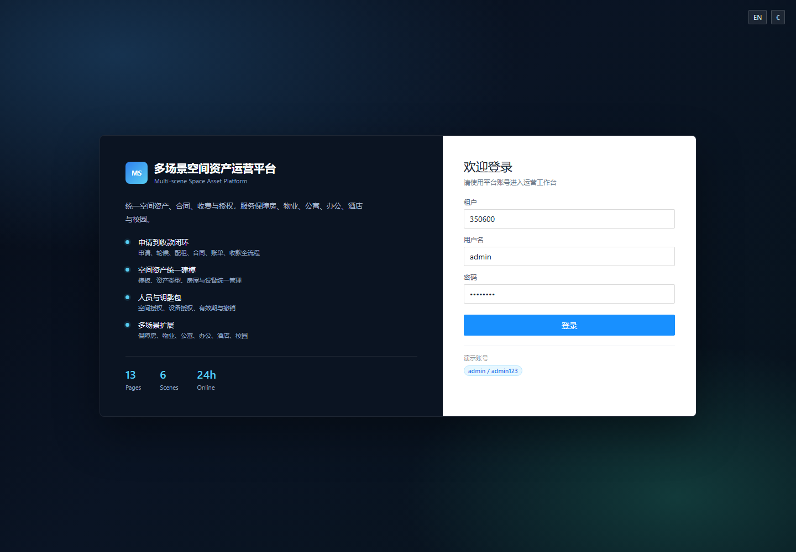
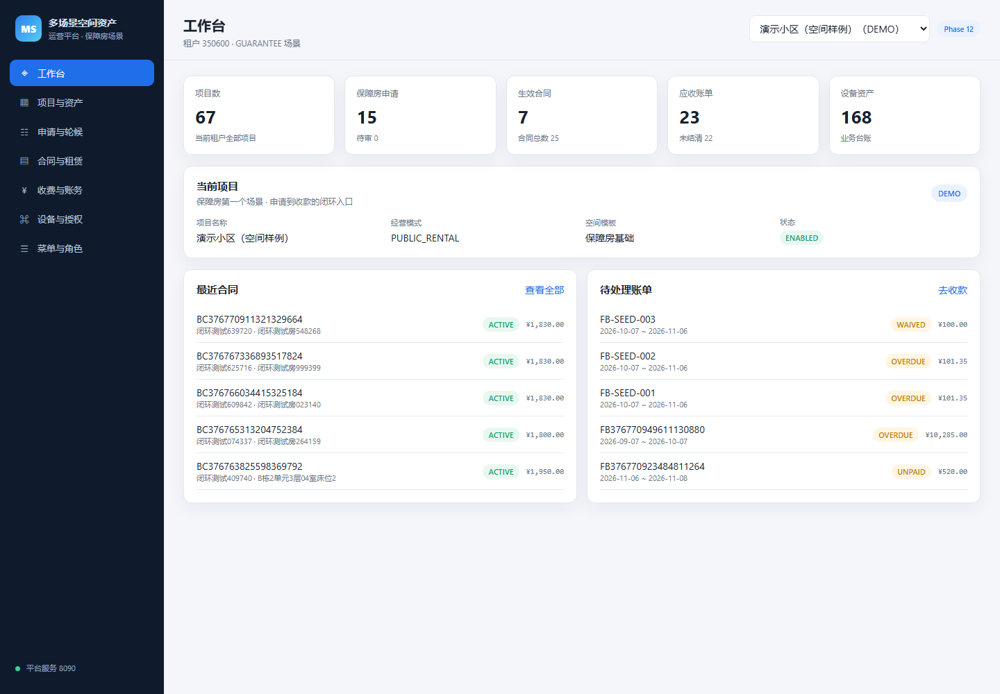

# 前端操作台说明

> 地址：`http://127.0.0.1:5174/`  
> 后端：`http://127.0.0.1:8090`  
> 场景：GUARANTEE 保障房





## 登录

```text
租户：350600
用户名：admin
密码：admin123
```

登录后 token 保存在 localStorage，API 自动携带 `Authorization: Bearer`。

## 页面

### 工作台

```text
项目数
保障房申请
生效合同
应收账单
设备资产
当前项目
最近合同
待处理账单
```

### 项目与资产
客户与人员

```text
项目列表
创建项目
选择当前项目
空间树
新增空间
房屋/房源
```

### 客户与人员

```text
人员列表
新增人员
人员钥匙包
```

### 申请与轮候

```text
创建申请
提交
审核通过
进入轮候
配租
```

### 收据打印

```text
收款记录
打印收据
收据号/金额/方式/时间
```

### 合同附件

```text
合同列表 → 附件
上传文件
附件列表
下载
```

### 合同与租赁

```text
合同列表
创建合同
生成租金账单
```

### 押金与补贴
欠费清单
资金流水
运营报表

```text
押金收取
押金退还
押金流水
租金补贴
```

### 合同变更

```text
租金变更
期限变更
换房
退租
提交审批
审批通过/驳回
```

### 审批中心

```text
工作流任务列表
通过
驳回
审批记录
```

### 收费与账务

```text
账单列表
按应付金额收款
收款记录
收据
```

### 公示管理

```text
配租公示
资格公示
退出公示
政策公示
草稿/发布/关闭
```

### 修改密码

```text
顶栏修改密码
原密码校验
新密码至少 6 位
两次确认
```

### 角色与菜单

```text
新增角色
角色列表
菜单授权
保存菜单
```

### 用户管理

```text
新增用户
角色绑定
启用/停用
重置密码
```

### 使用帮助

```text
业务操作顺序
平台版本
租户
前端/后端信息
常用入口
```

### 统一查询

```text
项目名称/编码
人员姓名/手机号
合同号
当前项目合同
```

### 监管报送

```text
合同/人员/账单汇总
日期范围
导出报送 CSV
```

### 消息中心

```text
系统消息
业务提醒
未读数
标记已读
全部已读
```

### 开放平台

```text
第三方应用
应用密钥
授权范围
启用/停用
```

### 我的待办 / 钥匙包 / 通行授权 / 设备告警

```text
独立待办列表
按人员钥匙包
独立通行授权
设备告警列表
```

### 补贴管理 / 抄表管理

```text
独立补贴登记
独立抄表录入
```

### 能耗分析

```text
按表类型汇总
表计用量排序
最近抄表日期
```

### 房源台账 / 空间层级

```text
独立房源台账
独立空间层级
新增空间
房态筛选
```

### 日房态

```text
未来 14 天
房屋占用
合同/短租/空置
前后 7 天切换
```

### 短租订单

```text
短租客人
入住/离店
晚数
金额
确认/入住/完成/取消
```

### 信用惩戒

```text
违规/欠费/其他
信用扣分
有效期
撤销
```

### 风险告警

```text
风险/欠费/设备/其他
级别
处理中/已解决/忽略
```

### 计费项目

```text
租金/押金/水电/服务费
计费周期
单价
税率
启用/停用
```

### 欠费清单

```text
未结清账单
欠费金额
逾期账单
```

### 资金流水

```text
收款记录
收据
```

### 运营报表

```text
申请/合同/账单/收款/设备汇总
账单状态分布
导出账单 CSV
```

### 服务与工单

```text
报修/投诉/巡检工单
新建工单
受理
完成
关闭
```

### 计量与能耗

```text
水表/电表/燃气表
新增表计
抄表
用量汇总
```

### 访客通行

```text
访客登记
被访房屋/人员
有效期
审批通过/拒绝
```

### 投诉与申诉

```text
投诉
申诉
走访
处理状态
处理结果
```

### 设备与授权

```text
设备台账
新增设备
人员授权
授权列表
撤销授权
```

### 设备与授权

```text
设备台账
新增设备
人员空间授权
```

### 菜单与角色

```text
GUARANTEE 菜单树
角色模板
角色菜单
```

## 启动

```powershell
cd platform-frontend
npm run dev
```

构建：

```powershell
npm run build
```

当前本地依赖通过 junction 复用老前端 `node_modules`，正式工程应独立安装依赖。

## 多语言

```text
显式 i18n：登录、侧边栏、页面标题
过渡层：复用旧系统中英文词条，匹配页面静态文案
?lang=en 可直接以英文打开
```

详见 `10-多语言与主题说明.md`。

## 菜单

按旧系统 8 个分组组织：

```text
工作台
风险与预警
保障服务
合同与房源
收费与账务
通行与设备
服务与监督
系统与数据
```

详见 `14-菜单结构对照.md`。

## 布局

```text
侧边栏折叠/展开
折叠状态记住
```

## 风格

参考原保障房系统：

```text
浅色侧边栏 + 白色内容卡片
Ant Design 蓝 #1890ff
2px 小圆角
56px 顶栏
紧凑表格
暗色/浅色切换
中英文切换
```

## 旧系统兼容

```text
登录兼容旧 PBKDF2 密码
登录后自动升级 BCrypt
平台管理链接旧平台 /platform-admin
```

## 分页

项目、账单、设备列表已增加分页：

```text
每页 10 条
上一页/下一页
总数和当前区间
```

## 权限

登录后调用：

```text
GET /api/v1/auth/menus?sceneCode=GUARANTEE
```

返回当前用户可用菜单：

```text
admin：全部菜单
steward：工作台、客户、申请、轮候、合同、审批、设备
```

前端：

```text
侧边栏按菜单过滤
主要创建/收款按钮按菜单隐藏
后端接口仍做 403 校验
```

## 说明

```text
后端 Long ID 已序列化为字符串
避免 JavaScript 超过 2^53 后精度丢失
项目选择保存在 localStorage
默认选择有合同/申请/设备数据的项目
```

## 下一步

```text
登录/租户切换
权限按钮级控制
押金/补贴页面
合同变更页面
审批中心页面
分页
错误提示统一
```
