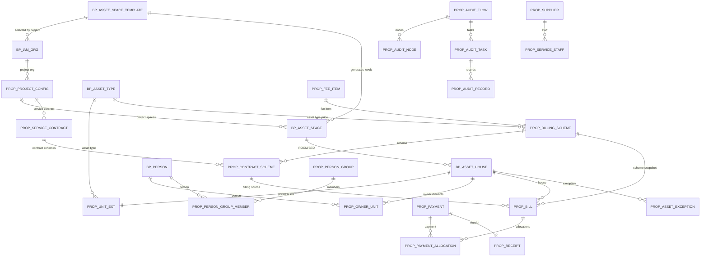

# 智慧物业 V1 ER 与 DDL 草案

> 状态：设计评审稿，未执行  
> 数据库：MySQL 8  
> DDL 文件：[property_v1_schema_draft.sql](D:/Work/业务平台开发/backend/sql/property_v1_schema_draft.sql)  
> 说明：只新增物业表；保障房核心表只做可空字段增量

---

## 1. ER 总览



---

## 2. 核心关系说明

### 2.1 项目

```text
bp_iam_org（PROPERTY_PROJECT）
→ prop_project_config（项目配置）
→ prop_service_contract（项目级物业服务合同）
```

项目选择：

```text
bp_asset_space_template  空间结构模板，平台资产基础配置
bp_asset_type           资产类型字典，平台资产基础配置
```

### 2.2 空间与房屋

```text
bp_asset_space
  项目 → 楼栋/期/苑 → 单元 → 楼层 → 房间
→ bp_asset_house
→ prop_unit_ext
```

`bp_asset_space` 增加：

```text
asset_type_code
space_template_id
level_no
```

`bp_iam_org` 增加：

```text
space_template_id
default_asset_type_code
```

### 2.3 人员

```text
bp_person
→ prop_owner_unit
→ bp_asset_house
```

人员照片：

```text
bp_person.face_photo_url 可空
```

### 2.4 合同与计费方案

```text
prop_service_contract（项目整体）
prop_lease_contract（租赁）
prop_billing_scheme（价格规则）
prop_contract_scheme（合同-方案关系）
```

账单：

```text
prop_bill
  contract_type
  contract_id
  scheme_id
  asset_type_code
```

### 2.5 审核

```text
prop_audit_flow
→ prop_audit_node
→ prop_audit_task
→ prop_audit_record
```

支持：

```text
单级
多级串行
平级多人
会签 ALL
或签 ANY
金额分级
```

---

## 3. 新增表清单

| 表 | 用途 |
|---|---|
| `bp_asset_space_template` | 空间结构模板，平台资产基础配置，租户级，物业/保障房/园区共用 |
| `bp_asset_type` | 资产类型字典，平台资产基础配置，租户级，多场景共用 |
| `prop_unit_ext` | 物业房屋扩展，资产类型、建筑面积、套内面积、交付状态 |
| `prop_service_contract` | 项目级物业服务合同，业委会/资产方 |
| `prop_billing_scheme` | 计费方案，按项目/资产类型/楼栋/房屋 |
| `prop_contract_scheme` | 合同与计费方案关系 |
| `prop_audit_flow` | 审核流程配置 |
| `prop_audit_node` | 审核节点，多级/并行/会签/或签 |
| `prop_audit_task` | 审核任务 |
| `prop_audit_record` | 审核记录 |
| `prop_person_group` | 人员组 |
| `prop_person_group_member` | 人员组成员 |
| `prop_supplier` | 供应商 |
| `prop_service_staff` | 服务人员 |
| `prop_asset_exception` | 资产异常 |

---

## 4. 已有表增量字段

以下字段为草案，执行前需确认：

```sql
-- bp_iam_org
space_template_id bigint null
default_asset_type_code varchar(64) null

-- bp_asset_space
asset_type_code varchar(64) null
space_template_id bigint null
level_no int null

-- bp_person
face_photo_url varchar(500) null

-- prop_fee_item
fee_category varchar(32) null

-- prop_bill
contract_type varchar(20) null
scheme_id bigint null
asset_type_code varchar(64) null
```

`prop_bill.contract_id` 已存在，复用为合同 ID。

---

## 5. 计费方案设计

### 5.1 范围

```text
PROJECT      项目
ASSET_TYPE   资产类型
BUILDING     楼栋
HOUSE        房屋/车位
```

### 5.2 取价优先级

```text
HOUSE > BUILDING > ASSET_TYPE > PROJECT
```

### 5.3 核心字段

```text
scheme_name
fee_item_id
fee_category
asset_type_code
scope_type
scope_id
unit_price
billing_cycle
start_date
end_date
auto_generate
scheme_status
version_no
```

### 5.4 唯一性

应用层校验：

```text
同一项目、同一收费项目、同一范围、同一生效期间不能重复
```

数据库不做复杂时间唯一索引，避免版本切换无法保存。

### 5.5 账单快照

账单保存：

```text
contract_type
contract_id
scheme_id
asset_type_code
unit_price
bill_amount
```

即使方案后续修改，历史账单不受影响。

---

## 6. 项目物业服务合同

```text
一个项目原则上有一份整体物业服务合同
签约方：业主委员会 / 资产方 / 产权单位
覆盖项目或项目内部分资产
不按每户生成
```

合同关联：

```text
prop_contract_scheme
  contract_type = SERVICE
  contract_id = prop_service_contract.id
  scheme_id = prop_billing_scheme.id
```

租赁合同：

```text
prop_lease_contract
  contract_type = LEASE
  contract_id = prop_lease_contract.id
```

账单统一记录：

```text
contract_type
contract_id
scheme_id
```

---

## 7. 审核流程

### 7.1 流程配置

```text
业务类型
项目
金额区间
节点顺序
审批人角色/用户
串行/并行
会签/或签
```

### 7.2 节点

```text
approve_mode = SERIAL / PARALLEL
approve_rule = ALL / ANY
approver_type = ROLE / USER
approver_value = 角色编码或用户ID列表
```

### 7.3 任务

```text
task_status = PENDING / APPROVING / APPROVED / REJECTED / WITHDRAWN
current_node_id
```

### 7.4 记录

```text
action = APPROVE / REJECT / WITHDRAW
comment_text
approver_id
action_time
```

---

## 8. 数据迁移映射

### 8.1 项目

```text
bp_iam_org (PROPERTY_PROJECT)
→ 选择默认空间模板
→ 默认资产类型
→ prop_project_config 只保留物业业务配置
```

### 8.2 房屋

```text
bp_asset_house
→ prop_unit_ext
→ asset_type_code 初始值：
   高层/多层/排屋/商业/商铺/办公/仓库
   无法判断时使用 UNCLASSIFIED
```

### 8.3 现有空间

```text
bp_asset_space
→ 设置 space_template_id
→ 设置 level_no
→ 设置 asset_type_code（可空）
```

### 8.4 现有收费项目

```text
物业费 → PROPERTY_FEE
能耗费 → ENERGY
水费 → WATER
电费 → ELECTRICITY
车位管理费 → PARKING_MGMT
租金 → RENT
多经/其他 → OTHER
```

### 8.5 现有账单

```text
contract_id 可空
scheme_id 可空
asset_type_code 可空
历史账单不强制回填
```

### 8.6 现有停车

```text
停车表和数据保留
车位管理费作为收费类别
停车运营迁移到智慧停车独立系统
```

---

## 9. 索引与约束建议

```text
bp_asset_space_template
  unique (tenant_id, template_code, version_no)
  index (tenant_id, scene_code, status)

bp_asset_type
  unique (tenant_id, scene_code, type_code)

prop_unit_ext
  unique (tenant_id, house_id)

prop_service_contract
  unique (tenant_id, contract_no)
  index (tenant_id, project_id, contract_status)

prop_billing_scheme
  index (tenant_id, project_id, scheme_status)
  index (tenant_id, project_id, scope_type, scope_id)
  index (tenant_id, project_id, asset_type_code, fee_item_id)

prop_contract_scheme
  unique (tenant_id, contract_type, contract_id, scheme_id, effective_from)

prop_audit_node
  unique (tenant_id, flow_id, node_seq)

prop_audit_task
  index (tenant_id, biz_type, biz_id)
  index (tenant_id, project_id, task_status)

prop_person_group
  unique (tenant_id, project_id, group_code)

prop_person_group_member
  unique (tenant_id, group_id, person_id)
```

---

## 10. 待评审问题

```text
1. 资产类型 UNCLASSIFIED 是否允许出账，还是必须补齐类型
2. 项目物业服务合同是否允许多份并存（分期/部分资产）
3. 合同方案的生效日期与账单周期如何切分
4. 审核流程配置放在项目级还是租户级
5. 人员组是否跨项目
6. 供应商是否必须绑定项目
7. 人脸照片存储路径、保留周期、删除策略
8. 现有账单是否需要回填 scheme_id
9. 车位管理费由业务平台出账还是停车系统回传
10. 空间模板变更对历史空间的影响
```

---

## 11. 结论

本草案明确了：

```text
空间模板
资产类型
房屋扩展
项目级物业服务合同
合同选择计费方案
资产类型差异化取价
多级/并行审核
人员组
供应商
资产异常
```

下一步应在评审通过后再写 `ALTER TABLE` 和 Java 实体，不要直接执行草案 SQL。
